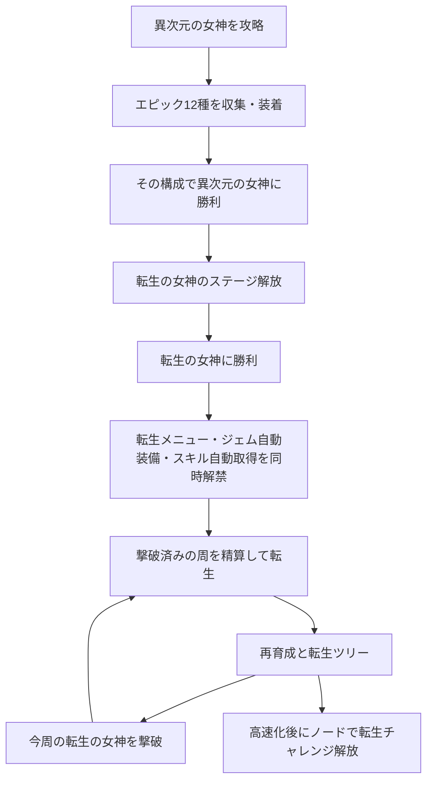

# 転生・転生チャレンジ・実績システム企画

2026-10-17作成、2026-10-18改訂。**企画検討中・本編未実装。転生ツリーはレビュー用モックを作成。**

ユーザーの原案を土台に、現行の装備・ジェム・経験値・自動周回との接続を補った企画書。本文の「指定」は今回の原案、「推奨案」「仮値」「候補」は追加提案であり、採用済みのゲーム仕様ではない。企画書の保存・コミットは実装開始を意味しない。

2026-10-18の実装着手指示を受け、まず[ツリーの見た目と内容の確認モック](reincarnation-tree-mock.md)を作成。今後の成果は `dev` へ集約する予定。本編への転生処理・保存・戦闘効果の接続は未実施。

**2026-10-18の指示・確認回答を優先する。** 毎周の転生に転生の女神撃破を必須とし、通常転生の基本ポイントはほぼ固定。序盤の主報酬は次周の所要時間短縮とする。前版の途中到達別ポイント、無料振り直し、転生10回での試練自動解放、自動化プリセットを主役にしたツリー、確率に掛けるドロップ倍率は取り下げた。

## 1. 企画の軸

初回は世界の奥まで進み、エピック12種を揃えて隠しボスを発見する。転生後は素材稼ぎと通常攻略を段階的に短縮し、毎周の転生の女神撃破までを速くする。高速転生が成立した後、回数で稼ぐ通常周回と、試練で1回の価値を上げる遊びを選べるようにする。

- 初回攻略の達成感は、転生を知らない状態で成立させる。
- 序盤は同じ基本ポイントでも次周が速くなること自体を報酬にする。
- 中盤の主目標は、経験値3倍とメイン材料無償化で、通常地域を途中の稼ぎ周回なしに攻略できる状態。
- その後は、ドロップ数倍率で女神前提の収集も短縮し、試練・スキップ・新しいステージ構造へ進む。
- 自動化の基本機能は転生解禁と同時に渡す。手作業を何周も要求してから便利機能を売る構成にしない。
- ツリーは周回構造の変化と、試練に釣り合う十分な火力・耐久を中心にする。便利機能の細切れ販売でノード数を埋めない。
- 転生ポイントの振り直しは用意しない。追加周回で別の枝を取得する。
- 実績は名誉と案内が中心。必須の能力報酬や転生ポイントの供給源にはしない。

### 現行仕様との接点

| 現行の事実 | 本企画での扱い |
| --- | --- |
| エピックは6職×武器・防具の12種。専用容量を使い、各部位1個 | 解放判定は「12個所持」でなく、12部位への合法な同時装着 |
| 異次元の女神は制限180秒。エピック完成構成では約20.9秒の試運転記録 | 新ボスは全エピック前提の別基準で調整。既存女神を強化して相殺しない |
| Lv上限100、経験値はレベル内の正規化進捗 | 転生後も上限100を維持。経験値強化は指数の加算で扱う |
| 女神強化で1職あたり追加SP60、Lv.100の基礎SPと合わせて160 | 転生のSP倍率と装備由来SPの適用範囲を分離する |
| 森10で装備強化自動取得を解放 | 転生後は解放と設定を保持し、最初から利用可能にする |
| 報酬はクリア時にまとめて付与。育成は次の戦闘開始時に反映 | 自動取得・自動装着も同じ境界で処理する |

根拠：[エピックと女神強化](../implementation/epic-gems.md)、[異次元の女神](../implementation/extradimensional-goddess.md)、[自動装備強化](../implementation/auto-gear-and-unlocks.md)、[報酬・性能改善](../implementation/run-flow-and-performance.md)、[バランス方針](../policies/balance-policy.md)。記録の約20.9秒から新ボスのHPを単純比例で決めることはできない。

## 2. 解放までの流れと秘匿

### 指定に基づく解放条件

1. 全6職の武器・防具に、それぞれ対応するエピックを装着する。
2. その構成で異次元の女神に勝利し、転生の女神を解放する。
3. 転生の女神を倒した時点で、転生メニューと2種類の自動化を解禁する。初転生を待たない。

判定は**戦闘開始時に固定した実際の構成と、その戦闘の勝利**で行う案を推奨する。戦闘中の装着変更は次の周から反映される現行仕様と揃える。12種の重複なし、職・部位・容量の合法性を確認し、戦士用12個の所持や勝利直前のメニュー変更では達成にしない。全員生存や薬禁止は条件に追加しない。

解放は永続。12種の再装着を要求するのは初回の発見条件だけとする案を維持する。一方で、**転生そのものは毎周の転生の女神撃破が必須**。火力・耐久の転生強化が進めば、必要なエピック再収集の程度も変わり得る。過去周の撃破記録だけでは転生できない。

### 表示段階

| 状態 | 表示するもの | 伏せるもの |
| --- | --- | --- |
| 異次元の女神をまだ発見していない | 到達済みの通常コンテンツと実績 | 女神名・姿・関連収集物・転生関連の全項目 |
| 異次元の女神に遭遇済み、エピック未発見 | 発見済みの女神情報 | エピック12種の条件、転生関連の全項目 |
| エピックを初入手 | エピック収集実績、12部位装着で女神に勝つ実績の条件 | 達成後の報酬、転生機能の存在 |
| 12部位装着で女神に勝利 | 転生の女神のステージ、発見演出 | 転生メニュー、転生ツリー、自動化の解禁予告 |
| 転生の女神に勝利 | 転生と自動化の解禁演出・メニュー | 未解放の試練詳細など |

実績のヒント文は「全6職の武器・防具にエピックを装着して、異次元の女神に勝利」。実績名は仮に「十二の星の証」。条件を示しても、転生・リセット・次の機能には言及しない。

「転生の女神」というボス名は原案どおり、本人のステージ解放後に表示する。ただし、その名前から先の機能を説明する文、未解放の転生ボタン、ツリーの影、転生ポイントの通貨欄は撃破前に出さない。

秘匿対象はメニューだけでなく、実績総数・達成率の分母・資料館・検索候補・ツールチップ・通知履歴・アクセシビリティ用ラベルにも及ぶ。隠し項目の件数から存在がわからないようにする。既存セーブで条件を満たしている場合、過去の構成付き勝利記録がなければ、所持品だけから達成を推測せず再挑戦を必要とする。

## 3. 転生の女神

### キャラクターと戦闘の方向

指定：金髪で、アホっぽいギャグテイスト。現代兵器・SF兵器を次々に持ち出し、最大の見せ場は大型トラックによる突進。

推奨するキャラ像は「物騒な道具の扱いに妙に自信があるが、毎回どこか抜けている女神」。重火器の反動でよろける、巨大砲の充電完了に本人が驚く、トラック爆発後に煤だらけで着地する、といった動きで性格を伝える。長い台詞を必須にせず、シルエットとリアクションで笑えるようにする。

ステージ名は仮に「女神の配送センター」。女神本体、兵器、トラックは既存戦闘画面のドット絵テイストに揃える。危険範囲の予告以外の弾・爆発・煙・タイヤ痕・光は画像素材を使う。2026-10-20に通常SF兵器5種・トラック大技・帰還ゲートを制作した。[攻撃企画と制作範囲](reincarnation-goddess-arsenal.md)を現行の詳細案とする。本編の戦闘登録とバランス調整は未実施。

| 行動 | 役割・見た目の案 | 攻略上の区別 |
| --- | --- | --- |
| パルス散弾機関砲 | SF三連砲の反動でのけぞる | 固定扇の短い連射。1人への合計被害上限 |
| 陽電子レール砲 | 巨大レール砲を充電、発射した本人が驚く | 固定直線の貫通1回。妨害で中断 |
| 追尾ミサイル配送 | 2基のポッドをリモコンで操作 | 最大3対象、時間差の小円。着弾前に地点固定 |
| 重力ブーメラン | 円盤を投げて勢い余る | 弧を往復、行き・帰り各1回と短い減速 |
| 衛星スタンプ砲 | 衛星へ大げさに命令して前のめり | 密集地点への単発円範囲。追尾し続けない |
| 大型トラック（大技） | 乗車→企み顔の待機→（＞v＜）突進 | 長い予備動作と妨害ゲージ。中断で涙目・安全な隙 |

通常は上のSF兵器5種。トラックは別枠の大技。モーション・範囲・想定効果・帰還の具体案は[専用設計](reincarnation-goddess-arsenal.md)へまとめた。

HP50%以下でSF兵器の比率を上げ、トラックの存在感も増す案。別HPへの交換や大きな無敵時間で180秒を削る構造は避ける。

### トラックの状態遷移

「待機中にトラックに乗る」は、大技の準備・待機区間で乗り込む動きとして整理する。

1. **呼び出し・乗車**：画面内の所定位置にトラック。女神が乗り込む。現在の制作案は3コマ・約0.76秒。
2. **発進待機**：空ぶかしとライト、エンジンの振動。突進の向き・範囲と妨害ゲージを固定。目安3〜4秒。
3. **中断成功**：女神が運転席で涙目になり、ギャグ爆発・煙で車両を回収。煤だらけの涙目被弾へ接続し、2〜3秒の隙。爆発は味方への罰にしない。
4. **中断失敗**：予告した方向へ突進。1人につき本体衝突1回まで。画面外で判定を継続しない。
5. **復帰**：急停車または乗り捨て、女神が通常行動へ戻る。次の行動へ予約を持ち越さない。

トラックはまず女神の大技演出・当たり判定として扱い、独立した敵・HP・報酬は持たせない案を推奨する。攻撃対象が分かれて火力や妨害が吸われる事故を避けられる。女神撃破・戦闘中断・時間切れ時には、車両と予約攻撃をまとめて清掃する。

既存の行動妨害と抵抗成長を使い、毎回必ず止まるだけの大技にしない。初回の待機時間と抵抗値は全エピック構成で測定して決める。中断の報酬は安全と攻撃機会を基本とし、自爆ダメージを強さの前提にしない。

### 難度と報酬

- 指定：エピック12個装着で、3分ぎりぎり程度の強さ。
- 推奨する基準構成：全6職Lv.100、通常地域・女神装備を完成、エピック12種、薬なし。通常ジェムとスキル配分も固定した合法な検証構成を用意する。転生強化は0。
- 仮の合格目標：固定30配置で30勝、撃破時間中央値170〜175秒、最長180秒以内。HP0到達が時間内なら撃破演出中の時間切れで負けない。
- 最適な通常ジェムをさらに積んだ構成まで一律に180秒へ揃えない。最適化と育成の余地を残す。
- 最大単発被害は既存方針の51%以内。連射・爆風などの連続被害もまとめて検査する。女神戦は通常地域の45〜150秒目安とは別の特殊基準とする。
- 主報酬は転生・自動化の永続解禁。新たな必須素材や第2のエピック収集をここで追加しない。通常のゴールド等は周回価値と合わせて後で決める。

「ぎりぎり」と「配置運で負けない」の両立が難しい場合、最長時間の合格を優先し、中央値に余裕を作る。既存記録からの推定だけで成立を宣言しない。

## 4. 転生でリセットするもの・保持するもの

「持ち物とレベルをすべてリセット」「解放したシステムはそのまま」を、**その周の育成状態**と**永続の発見・利用権**に分ける。以下は境界を具体化する推奨案。

| 対象 | 転生後 |
| --- | --- |
| 全キャラのレベル・経験値進捗 | Lv.1・進捗0に戻す |
| ゴールド・端数、素材、薬、ジェム、破片、女神素材 | すべて0。装着中・保護中も含む |
| 武器・防具・女神装備の取得ノード | すべて未取得。専用容量や装備由来SPも失う |
| スキル取得ランク・使用済みSP | すべて戻す。初期無料行動のみ再設定し、Lv.1と永続強化からSP予算を再計算 |
| 今周のステージクリア・通過・初回報酬受取記録 | リセット。森1から進行し直す |
| 過去に加入した仲間 | **毎周の再加入が必要**。存在・加入場所は判明済みだが、最初から全員は使えない |
| 機能・レシピ・装備ページ・特殊ボスの解放 | 保持。利用権は残すが、今周の到達・購入条件は別途必要 |
| スキル・装備・素材・敵などの発見記録 | 保持。どこに何があるか、必要条件がわかる |
| 転生機能・自動化・実績・資料館・チャレンジ解放 | 保持 |
| 転生ポイント・転生ツリー・試練の恒久進行 | 保持 |
| 自動化の優先度・解体設定・表示設定 | 保持。ただし消えたジェム個体IDへの固定指定は解除 |
| 戦闘中の未受取報酬・召喚・妨害・周回予約 | 破棄。戦闘終了を待つか転生確認で中断を明示 |

発見記録が残っていても、森1から終盤へ直接飛べる状態にはしない。見えている未到達ステージには今周の到達条件を表示する。特殊ボスも「発見済み」と「今周入場可能」を分ける。転生の女神は、今周の異次元の女神を倒せば入場でき、12種装着の解放儀式は繰り返さない案。

再加入時は現行の加入処理を基準に、加入Lv・装備・スキルの初期補填をその周に1回だけ行う案。これは毎周の再加入に付随する初期化であり、同じ周で何度も受け取れる報酬ではない。ステージスキップで加入地点を通過した場合も加入を成立させる。前版の「全員Lv.1で最初から使用可能」は不採用。

転生直後の所持品は0。ただし後述のツリーによる「必要素材の軽減・無償化」「経験値」「ドロップ数」「ステージの飛び越し」で立ち上がりを速くする。ジェムや完成装備を持ち越す機能は基本案に入れない。

### 安全な確定操作

転生画面に、獲得ポイント、失う物、保持されるもの、次周の主な倍率をまとめ、確定前の1画面で確認できるようにする。初回はリセット内容を十分に説明し、2回目以降も確認を残す。自動転生は初期実装の対象にしない。

確定処理は「今周報酬の確定→ポイント加算→育成初期化→新周開始待ち」を1回だけ成立させる。同じ確定操作の連打・再読込でポイントが増えないこと、初期化だけ行われないことを保存単位で保証する。取り消しなら一切変えない。転生前バックアップ1世代の保持も候補とし、復元時は通貨・所持品を含むセーブ全体を戻す。

## 5. 転生ポイントと周回時間

### テストプレイの体感を設計基準にする

以下はユーザーの体感・見積もりであり、今回の自動検証の測定値ではない。周回時間は実時間として扱い、今後の計測ではゲーム速度とリザルト等の実時間を分けて記録する。

| 区間 | 時間感・攻略の構造 |
| --- | --- |
| 通常地域〜魔王城 | メイン装備だけで攻略でき、数時間で通過可能 |
| 次元の門 | 通常メイン構成で容易にクリア。その後約6時間、トレハン収集と装備完成・容量拡大を進める |
| 混沌の門の前提作り | さらに約1時間 |
| 女神の安全ラインまで | 門を追加で約6時間周回 |
| 異次元の女神〜エピック収集 | 約6時間。初期180秒の戦闘も、2倍速では実時間90秒。トレハンとエピックでさらに短縮 |

通常攻略が数時間なのに対し、女神・転生へ向かう初回全体は半日以上〜1日弱という体感。後の収支計算でもこの時間規模を基準とし、トレハン・装備・エピックが途中で育つ過程を含めて再現する。大きな律速は装備・容量・ジェムのための収集であり、ドロップ数倍率とコスト軽減が有効に働く。

### 転生とポイント精算

- **今周の転生の女神撃破を転生条件とする。通常ステージ・門・異次元の女神での途中転生は用意しない。**
- 撃破後は転生を実行するまで今周を継続できる。同じ周の再撃破で転生ポイントを積み増さない。
- 通常転生の基本ポイントPは原則一定。速度・素材所持量・通常地域の到達段階では増減しない。
- 初回の転生の女神撃破後も同じPで初転生できる。過去の周の撃破記録を再利用しない。
- 転生の実行で初めて精算する。同一周の精算は1回。通常の所持品報酬と転生ポイントを分ける。
- 試練の成功時は `floor(P × C)`。初回達成・最高倍率の恒久報酬は別管理し、放棄した試練には与えない。
- 基本ポイントを後から増やすノードは初期案に入れない。最初は同じPをより短い時間で獲得することが成長。

P=100は価格を考えるための仮の単位。100そのものに意味はなく、実装前に価格との比率を決める。以前の「通常50からポイント獲得」「最高到達の報酬表」は廃止。

### 進行の4段階

| 段階 | 目標 | 主な報酬・次に変わること |
| --- | --- | --- |
| 初期の転生 | ドロップ数2倍・経験値3倍・必要な費用軽減 | 門と女神の収集時間、通常地域の育成待ちを減らす |
| 主目標への投資 | メイン材料無償化。優先して狙うと5〜8回程度 | 自動メイン取得と経験値3倍を合わせ、通常地域の途中稼ぎをなくす |
| 高速転生の確立 | ドロップ数をさらに増やし、女神前提の収集を短縮 | 毎周数時間、さらに短い周回へ。ここで試練とステージスキップへ分岐 |
| 長期の発展 | 速い通常周、複合試練、追加敵・別ルート | 回数の効率、1回の報酬、初回突破報酬を選ぶ |

試練解放を単なる転生10回の到達報酬にはしない。高速化した転生でポイントを貯め、転生ツリーの解放ノードを取得する流れにする。

## 6. 転生ツリー

### ツリーの設計原則

収穫・成長・再走構造・火力・耐久・技能・容量・試練へ分岐する。前版の76種類という数には固定しない。便利機能のプリセットや表示切替を有料ノードとして並べる案は外し、周回時間と攻略可能な制約が変わる内容を充実させる。

- 最初は複数の短縮要素を買い、メイン材料無償化へ投資する。
- その先で、さらなるドロップ数、ステージスキップ、試練解放、十分な火力・耐久へ分岐する。
- 火力と耐久は少量加算だけで終わらせず、後半に×2・×3などの大きな節目と追加ランクを置く。
- 2026-10-18の追加レビュー指示：強化系は節目の間を飛ばさず、中間ノードを増やして段階的に伸ばす。第3版モックでは火力・HP各18段階、技能16段階、容量17段階、個数21段階、ドロップ率15段階、ゴールド9段階を用意する。火力・HPの到達倍率は前段階の最大1.5倍までとし、100万PT級への中間価格帯も埋める。
- 通常攻略を再び難しくするよう敵を自動追従強化しない。強くなった結果、通常転生が楽になることを認める。
- 前提・費用・取得後の効果は事前に見せる。振り直しなしでも、次に何を買えば進むか分かる配置にする。
- 自動化の基本、設定変更、保護、探索可能な情報は有料の報酬にしない。
- 2026-10-18のモックレビュー指示：後半を1,000 PT程度で頭打ちにせず、通常100 PTの100倍・10,000倍に当たる10,000〜1,000,000 PTの価格帯を置く。試練の取得量増加と合わせて進行を設計し、通常周回数だけを取得時間として扱わない。
- ジェム制限でトレハンを得られない場合に備え、ジェムと独立して有効なドロップ率ノードを複数段階用意する。個数倍率とは分ける。
- ジェム制作の費用軽減は全費用を削らず、大ボス素材を段階的に減らす。4段階で必要量75%→50%→25%→0、最後は欠片だけで制作できる案とする。欠片の費用は維持し、端数は切り上げる。

### 主目標：メインノード材料無償化

**確認済み：通常10地域・全職・武器／防具のメインノードの素材費だけを0にする。ゴールドは必要。** サブ・ユニーク・女神ツリー・ジェム制作は対象外。

経験値3倍、メイン自動取得ON、必要なゴールド収支を揃えることで、通常100まで途中の出稼ぎ周回を要しない状態を目標にする。全ノードの無償化でも、前提・今周の到達条件の解除でもない。

現行メイン素材費は主に1〜2個。20%引き程度では切り上げ後に値が変わらない。そのため、序盤の割合軽減は高額のサブ・ユニークに適用し、メインは無償化の節目で明確に変える。ゴールド不足や自動取得のサブ消費で結局停止するなら、目標未達として収支・取得順を修正する。

メインのためのゴールドをサブ・ユニークが使い切らないよう、メイン優先設定か必要額の確保を無償の基本設定として整える。便利機能の有料ノードにはしない。手動で別用途に使った場合まで進行を保証するわけではない。

### 初期の価格例

P=100と置いた比較用の仮値。価格は未採用であり、主目標へ5〜8回程度という指示を優先して調整する。

| ノード | 仮価格 | 役割 |
| --- | ---: | --- |
| ドロップ数1→2倍 | 60 | 最初の大きな収集短縮 |
| 経験値3倍 | 20 | 通常地域のレベル待ち短縮 |
| ゴールド2倍 | 20 | ゴールド収支の安定。素材数倍率とは別枠 |
| ドロップ数2→3倍 | 80 | 収集をさらに短縮 |
| ドロップ数3→4倍 | 120 | 女神の前提作りを短縮 |
| 通常サブ素材費20%軽減 | 20 | 容量拡大までの負担を軽減 |
| 通常ユニーク素材費20%軽減 | 40 | 装備完成の負担を軽減 |
| メイン材料無償化 | 400 | 経験値3倍・上記2種の費用軽減から接続する主目標 |

例：初転生で「ドロップ2倍・経験値3倍・ゴールド2倍」。以後、費用軽減と主目標へ優先投資すると合計560ポイントで6回程度、途中でドロップ3・4倍も取ると合計760ポイントで8回程度。これは価格合計の例で、所要時間の実測ではない。貯蓄する数周にも短縮が残るかを確認する。

### 系統別の効果候補

効果量・上限・ランク数は仮。初期〜主目標までは収集短縮を中心にし、強い火力・耐久ノードは試練解放付近以降へ置く。

| 系統 | 基礎・中間ノード | 大きな節目・後半候補 |
| --- | --- | --- |
| 収穫 | ドロップ数＋1、ジェム非依存のドロップ率の複数段階、ゴールド＋100% | ドロップ数＋2・＋4、最終ドロップ数×2、ドロップ率の上位段階、ゴールド×2 |
| 成長 | 経験値指数＋1＝3倍 | 追加の指数＋1、経験値制約への対抗。Lv.100到達後の効果がないことも明示 |
| 再走構造 | サブ・ユニーク素材費軽減、装備ゴールド費軽減 | メイン材料無償化、ステージスキップ、スキップ幅拡張 |
| 火力 | 与ダメージ＋25%、通常・スキルの別枝、妨害力・再使用回復 | 与ダメージ×2・×3を複数の節目に配置。ボス・乱入敵向けの枝 |
| 耐久 | 最大HP＋25%、防御・MP・回復・バリアの枝 | 最大HP×2・×3、継続被害や連続攻撃に対応する生存強化 |
| 技能 | レベル由来SP倍率、10Lvごとの追加SP、技能威力・MP消費軽減 | 追加ランク、SP制約や少人数編成の補強。振り直し機能は報酬にしない |
| 宝石・容量 | 攻撃・防御・補助・共通容量の別枝、制作時の大ボス素材軽減 | 大容量の節目、大ボス素材無償化（欠片のみで制作）。職専用容量は別管理 |
| 試練・異変 | 試練解放、独立した制約系統、選択枠追加 | 上位制約、乱入敵、人数制限、分かれ道・別構造のステージ |

系統間には、収穫→再走無償化、再走→スキップ、火力＋耐久→高難度試練、容量＋技能→少人数攻略、といった接続を置く。全系統を全取得してから次へ進む一本道にはしない。試練の追加敵・新ステージは、ノード取得で参加条件を開けるだけでなく実体の制作を伴う拡張として扱う。

### ステージスキップ

高速転生の確立後、試練解放と同じ時期の選択肢として置く。通常進行は現在地点＋1、最初のスキップは＋2まで挑戦先を選べる案。1→3→5のように間の1ステージを省く。大ボスを越えず、直前なら必ず大ボスへ着地する。必須の特殊ボスも飛び越さない。

**確認済み：飛ばした区間は進行条件だけ満たし、経験値・素材・ゴールドを与えない。** 通常クリア報酬・ジェム抽選・クリア回数稼ぎ・実績解除を自動でまとめ取りしない。

- スキップ先の勝利時に、間のステージを「通過」として確定する。実クリアと区別して保存する。
- 装備メインの購入条件、地域ページ、加入地点、通常の進行ゲートは通過で満たす。スキップで魔法使いの加入地点等を失わない。
- 戦闘開始前に、飛ばす予定だけで前方の装備や仲間を先取りしない。スキップ先への敗北で通過記録を増やさない。
- 未達の初クリア実績が欲しければ、対象を実際にクリアする。既存の生涯実績は残る。
- 着地先の経験値・報酬はそのステージの通常ルール。失った区間の報酬は後から繰り越さない。
- スキップ後の稼ぎや再挑戦は可能。飛ばすか通常順かを選べるようにする。
- 省略区間で得られないLv・装備・ゴールドを補える強化が必要。メイン材料無償化＋経験値3倍だけで、スキップ後の戦力まで保証しない。

戦闘回数は大きく減るが、1→3を解放しただけで実時間が必ず半分になるとは断定しない。大ボス・特殊戦・素材稼ぎ・報酬演出は残り、敵の強さも上がる。＋3以上への拡張はその後の節目。素材稼ぎの必要性が下がってから解放し、報酬を捨てた結果かえって遅くなる初期の罠にしない。

### ドロップ数倍率：抽選後の個数をN倍

**指定：Nは整数。素材・ジェムのドロップ個数を常にN倍し、確率には干渉しない。** ドロップ数2倍を取得後、対象アイテムが1個だけ落ちることはない。倍率を小数で成長させるノードは置かない。

まず現行どおり、基本確率pにトレハンHと既存の特殊ステージ倍率を適用して個数Kを決定する。最後に `獲得個数 = N × K`。例えば `q = p × (1 + H)`、`K = floor(q) + Bernoulli(q - floor(q))`。素材の種類・ジェムのレア度ごとに扱い、低確率の排他関係と100%超過の端数区間は現行方式を維持する。

| 基本確率 | N | トレハン | 最終結果 |
| --- | ---: | ---: | --- |
| 30%で1個 | 2 | 0% | 30%で2個、70%で0個 |
| 30%で1個 | 2 | ＋300% | q=1.2。2個確定＋20%でさらに2個、つまり2個80%・4個20% |
| 100%で1個 | 2 | ＋50% | 2個確定＋50%でさらに2個。3個にはならない |
| エピック1% | 2 | ＋300% | 4%で2個、96%で0個 |

同じ期待個数でも前版の確率倍率とは分布が異なる。例えば30%・N=2・トレハンなしは、60%で1個ではない。レア物の当たり待ちはトレハン、当たった時の量はNが担当する。平均収支だけでなく、初入手までの時間のばらつきも後のバランス確認に含める。

**確認済み：増えたジェムは各個体を別生成する。** レア度・地域Lvは抽選結果を引き継ぎ、能力・品質・IDをそれぞれ抽選する。エピックは能力固定なので、個体生成時に12種の抽選を行う案。高Nは同一個体の複製ではなく、良い個体・不足種を探す速度にも効く。

適用外は、転生ポイント、初回の固定配布、加入処理、実績、制作・変換・解体の出力。ゴールドはトレハンと専用ゴールド倍率で扱う。生成したN個を解体すれば、そのN個分の破片は得るが、破片へ再度Nを掛けない。制作費軽減は制作→解体→再制作で資源が増えないことを採用条件とする。

### 能力・経験値・SPの計算

| 対象 | 方針 |
| --- | --- |
| 与ダメージ | 転生内の加算をまとめ、節目の倍率と通常育成を定めた順序で適用。追加Hit・複写・反射・召喚・DoTへ二重適用しない |
| 最大HP | 基礎・装備・スキル集計に永続強化を適用。敵を現在HP比例に変えて強化を相殺しない |
| トレハン | 永続分はパーティー共通で1回加算。6人それぞれへ加えて6倍にしない |
| 経験値 | `有効ステージ = 報酬ステージ + x`。正の巨大な累乗を計算せず正規化進捗へ接続。上限100、表示％、3^(-20)以下は0を維持 |
| 容量 | 方向・共通・職専用を区別。共通容量で職専用を代替しない |

SPの概念は `floor(L × (1 + a)) + b × floor(L / 10) + 装備SP` を維持する。Lは現在Lv、aはレベル由来SP倍率の追加分、bは10Lvごとの追加SP。装備SPは基本的に乗算しない。L=100、a=0.2、b=1、装備SP60なら190。

ただし、`1.1`等を二進浮動小数点で累積し、そのままfloorする実装は避ける。倍率は整数の刻みや有理数で保持し、例えば倍率を分母1000の整数rで表せるなら、`floor(L × (1000 + r) / 1000)`として総予算を求める。試練のSP係数も同じ方法で組み合わせ、途中と最後のどこで丸めるかを固定する。

将来の必須テストは、Lv.1〜100、各ランク境界、10Lv境界、倍率1.1・1.2等の整数になる積、まとめてレベル上昇、装備SPの増減、減算・再取得・再読込、試練開始・放棄。整数モデルと全結果を比較し、SP不足・余剰や購入可否が1ポイントずれないことを確認する。今回この実装・テストは行わない。

### 振り直しを設けない

転生ポイントは取得型の永久投資とする。払い戻し・全振り直し・構成ごとの付け替えを基本仕様に入れない。試練では所有効果の一部を一時制限し、放棄後に戻す。設定の優先度変更や既存の通常スキルの振り直しとは別の話。

ノードはポイント入手後に取得でき、戦闘中の購入は現行の育成同様に次戦闘から反映する案。試練の制約自体は開始時に固定する。誤購入を避ける購入確認と先の効果の表示を用意し、未実装の振り直しを前提に高価な選択をさせない。

## 7. スキル自動取得

指定：転生解禁時に機能解禁。スキルごとに7段階の優先度。同じ優先度では高いレベルのものを優先する。

### 基本ルールの推奨案

- 優先度は**1が最高、7が最低**。利用しない設定は優先度とは別のON/OFF。
- **確認済み：「高いレベル」はスキルの解放Lvを指す。** 同じ優先度なら、取得ランクより解放Lvの高さを優先する。
- 比較順は、優先度の数値が小さい順→解放Lvが高い順→保存された手動順または固定ID順。同じ条件なら再読込でも同じ取得結果。
- 購入可能な1ランクを取り、候補を更新して繰り返す。同条件なら上位候補を先に上限まで育てる。未解放・前提不足・最大ランク・対象外は飛ばす。
- 高優先度スキルがまだ解放されていなくても、標準ではSPを貯めず取得可能な候補へ使う。SP予約は高度設定の候補。
- 前提スキルは勝手に優先度を変えない。必要な前提がOFFなら停止理由をアイコンとホバーで示す。
- 手動取得・減算・振り直しと競合させない。編集画面を開いているキャラの自動処理を止め、閉じた後にまとめて再評価する。手動で下げた直後に買い直す事故を防ぐ。

| 分類 | 初期優先度 |
| --- | ---: |
| アクティブ | 1 |
| 攻撃系パッシブ | 2 |
| その他パッシブ | 3 |
| スキル個別強化 | 4 |
| 予備 | 5〜7 |

通常攻撃の有料強化も初期優先度1へ含める案。無料の基本行動は購入対象外。攻撃系パッシブは表示名の文字列で判定せず、定義タグで分類する。複合効果は初期分類を固定し、個別変更を許す。

SP増加、レベル上昇、前提の取得・解除、設定変更だけを再評価の契機にする。毎フレーム全スキルを調べない。Lvがまとめて上がった場合は合算後に1回処理する。変化のないチェックを繰り返さない。

自動でプリセットを切り替える場合は、以後の取得方針だけを変更する。取得済みランクを勝手に減算して再配分しない。構成の振り直しを伴う適用は、対象と変更量を見せた手動操作にする。

## 8. ジェム自動装備

### ユーザーが指定する条件

基本機能は転生の女神撃破と同時に解禁。初回は設定を確認してONにする導線とし、所持ジェムを勝手に入れ替えない。自動装備と自動解体のON/OFFは別。

- キャラ・武器／防具ごとの優先効果。例えば「攻撃→再使用回復→MP回復」、支援職は「回復・補助→MP回復」など。
- 数値優先か容量効率優先か、最低レア度、対象から除外する効果、エピックの優先。
- 各キャラ・部位を埋める順序。1個の共有ジェムを複数箇所で取り合わないために必須。
- 現在の装着を固定するロック。解体保護とは別に扱う。保護した未装着ジェムは装備候補にできるが、固定装着は動かさない。
- 明示した場合のみ他キャラからの移動を許す。標準は未装着と、その部位自身のジェムから選ぶ。

基準プリセットは用意するが、最適編成を保証する機能とはしない。優先条件どおりの安定した近似選択と、手動構成の固定を重視する。複数方向容量・共通容量・専用容量・割引・職制限は手動装着と完全に同じ判定を使う。

### トレジャーハント最優先の具体的な挙動

**指定：トレハン持ちを優先し、補助容量を余計に使う個体は避けるが、代わりがなければ装備する。** 「効率の悪いものを候補から全部除外」にはしない。

評価対象は1個の数値だけでなく、合法な組合せ全体のトレハン合計。まずトレハン合計を増やし、同程度なら混雑する方向容量の消費が小さい構成を選ぶ。その後に第2・第3の指定効果、同点なら現状維持を使う。異なる効果の生の数値を足して比較しない。

説明用の仮個体で、補助容量100・共通容量0の1部位なら次の挙動を目標にする。数値は実際のジェム生成定義ではない。

| 候補 | トレハン | 補助容量消費 | 選択の例 |
| --- | ---: | ---: | --- |
| A：補助効果が重なった個体 | ＋20% | 100 | これしかなければ装備 |
| B・C：軽い個体が2個 | 各＋20% | 各50 | AよりB＋Cの計40%を優先 |
| D：1個では高い数値 | ＋30% | 100 | B＋Cの計40%には劣る。単体数値だけでDを選ばない |

共通容量で余剰を吸えるか、ほかの効果が別方向を使うかも加味する。トレハン最優先なら、副効果が多いという理由だけで容量の重い個体へ交換しない。同じ個体を全12部位で二重利用せず、必要なら近い部位間の交換も限定探索する。

### 計算方法の推奨案

1. 個体ごとの効果・職・部位・容量を1回解釈してキャッシュ。設定ごとの評価も版番号を付けて再利用。
2. クリアで得たジェムをバッチ登録し、職・部位・優先効果の索引を更新する。1個ずつ全装備の組合せを探索しない。
3. 影響する部位だけをdirtyにする。新規ジェムが関係しない職や、設定が変わっていない部位は再計算しない。
4. 各部位で条件ごとの上位候補を絞り、現在の装着・固定品・容量の異なる候補も必ず含める。単純な上位件数だけでは、小型の組合せを落とすため、容量帯・効果別に候補枠を分ける。代替なしの高容量トレハン個体を消さない。
5. 優先順と容量を使う貪欲法＋1〜2個の入替探索を候補にする。全個体を使った組合せの総当たりは行わない。
6. 変更案を全体で検証してから一括反映。同点なら現在装着を維持し、入手順とIDで安定させる。職間のジェム往復を防ぐ。

候補数・探索回数・処理時間の上限は実測で決定する。高レア大量ドロップでも描画フレームを長時間止めないよう、処理を分割し、次の戦闘開始前に必要分を確定する。上限に達したら合法な現在構成を残し、半端な装着状態を保存しない。

容量増加・割引変更・スキル設定変更・個体削除・設定変更・セーブ切替・転生でも関係するキャッシュを無効化する。完成後の主要目標は「1個入手ごとの全個体×全12部位再探索が発生しないこと」。単に速いPCで動いたことを性能合格にしない。

### クリアから次の戦闘までの順序

報酬抽選・付与→装備強化自動取得→SP総予算とスキル自動取得→容量等を確定→ジェム自動装備→保存→次戦闘の構成固定。

自動解体の既存設定を先に適用すると、欲しい候補を捨てる危険がある。推奨は「解体候補を一時保留→自動装備で採用・保留する個体を除外→残りだけ自動解体」。装着・保護・手動ロック品は常に除外する。解体候補も含めてクリア精算を1回だけ成立させ、再読込で報酬や破片を二重取得させない。

自動装備がOFFのときは既存の自動解体を維持する。プレビューと採用理由は設定画面に置き、ジェムの効果ツールチップへ説明文章を増やさない。

## 9. 転生チャレンジ

### 解放と目的

**指定：高速化した転生でポイントを稼ぎ、転生ツリーのノードで解放する。** 転生10回での自動解放・3回での先行解放という前版の条件は廃止。

メイン材料無償化と収集短縮が進んだ先に「試練の扉」を置き、ステージスキップと同程度の時期の選択肢にする。通常転生を速く回すか、試練で1回あたりのポイントと恒久報酬を増やすかを選ぶ。前提を厳密に「全高速化ノード取得」に固定せず、少数の節目ノードから接続する。

試練は原則、転生精算後〜新しい周の開始前に選ぶ。制約系統・段階・参加人数・追加敵・報酬倍率を開始前に表示して固定する。**試練でも転生の女神撃破が精算条件。通常100や門だけの途中精算は設けない。**

### 制約ツリー

敵側強化・味方側制限を独立系統として持つ。同系統の段階は順に解放し、系統を組み合わせて難度を上げる。転生ツリーで上位ノード・新系統・同時選択枠を解放する。

| 系統 | 初期段階の候補 | 後半の拡張・役割 |
| --- | --- | --- |
| 硬殻 | 敵HP＋25% / ＋60% / ＋120% | さらに高いHP倍率。永続火力の投資先 |
| 猛威 | 敵攻撃＋15% / ＋35% / ＋70% | 高い攻撃倍率・連携。永続耐久の投資先 |
| 渇き | 回復量×0.8 / 0.65 / 0.5 | 回復以外の防護・吸収・バリアを考える |
| 枯渇 | MP回復×0.8 / 0.6 / 0.4 | 消費軽減・回復ジェム・スキル構成の選択 |
| 宝石封印 | エピック無効→レジェンダリー以上無効→全ジェム無効 | 転生の火力・耐久・SPで装備依存を乗り越える |
| 倹約 | 通常装備サブ無効→サブとユニーク無効 | メインと永続強化で挑む。女神ツリーの扱いは別途明示 |
| 未熟 | レベル由来SP×0.8 / 0.65 / 0.5 | SP恒久強化と技能選択を活かす |
| 遅学 | 経験値指数−1 / −2 / −3 | 時間だけが増える内容になりやすいため優先度低め |
| 乱入 | 指定区間に追加の敵・強敵が参加 | 新しい対処・攻撃の組合せで難しくする |
| 孤軍 | 参加上限3人→2人→1人など | 編成と自立性能で攻略法を変える |

初期数値は仮。最終的な難度上限を現在の未転生火力・耐久へ合わせない。対応する永続強化と初回報酬を十分用意し、数周後には以前厳しかった試練が楽になる進行を作る。

上位段階は置き換えで、封印の重複等を二重加点しない。参加していないキャラの能力封印など、実際に制約にならない組合せも加点対象から外す。自動化や発見記録を奪って操作負担だけを増やす制約は初期案に入れない。

### 毎回のポイント報酬

各制約ノードへ難度点Qを付け、合計に応じたCで `floor(P × C)`。比較用の出発点は `C = 1 + 0.10 × Q` とするが、係数・配点は未採用。前版の3倍上限は長期の固定上限にしない。

点数は制約の見た目ではなく、想定強化・編成ごとの所要時間と突破難度で調整する。乱入や人数制限も同じ尺度へ換算する。「いつもの使わない要素を封じるだけで大幅増益」にならないよう確認する。

周回速度と1回の報酬は別の選択肢。通常周の方がポイント毎時で有利な段階があってもよく、試練は下記の初回報酬・最高倍率の更新でも動機を作る。毎回の試練報酬を初回報酬と混ぜて表示しない。

### 各試練ノードの初クリア報酬

**指定：個々の試練ノードに初回の強化報酬を用意する。** 通常の実績とは別の、攻略による恒久成長として管理する。ノードごと・段階ごとに1回。対象を選んだだけ、途中のステージだけ、放棄した周には与えない。

| 系統 | 初回報酬の方向案 |
| --- | --- |
| 硬殻 | 恒久与ダメージ増加 |
| 猛威 | 恒久最大HP・防御増加 |
| 渇き | 恒久回復・バリア強化 |
| 枯渇 | 恒久MP回復・消費軽減 |
| 宝石封印 | 共通容量、またはジェムに依存しない火力・耐久 |
| 倹約 | 装備の再構築を助ける費用軽減・恒久能力 |
| 未熟 | 恒久追加SP。整数の総予算へ加算 |
| 遅学 | 成長補強、または汎用能力。後半でも報酬の役割が残るものを選ぶ |
| 乱入 | 追加敵に対応する能力・別の敵やルートの解放 |
| 孤軍 | 生存・MP自給など少人数で役立つ恒久能力 |

共通の火力・耐久を土台に、系統ごとの特徴を少し加える案も可。報酬をその試練内でしか役立たないものに限定しない。強さは転生ツリーと合算して調整し、次の段階へ挑みやすくなる量にする。

複数系統を同時に達成した場合は、その周に選択した未達ノードの報酬をまとめて受け取れる。選択していない下位・別枝を自動で全解除しない。上位の挑戦条件として必要な下位初クリアと、転生ツリーによる追加解放を分ける。

初回報酬の付与は、条件付きの転生の女神撃破で成功を確定し、転生精算でポイントと一緒に1回だけ付与する案。放棄後に過去の撃破を流用しない。現在周で保留中の報酬と、生涯で取得済みの報酬を分けて保存する。

### 合計倍率の最高記録も強化へつなげる

**指定：実際にクリアした合計倍率の記録でも成長する。** 選択画面の倍率や途中到達では更新しない。成功精算したCの最大値を生涯最高記録Cmaxとして保持する。

推奨は、例えばCmaxが1.5・2・3・5・8…に達した時、恒久火力・最大HPなどを1段階解放する方式。反復回数を足す方式ではない。同じ倍率の再クリアでは記録報酬を増やさない。倍率表示の丸め値で閾値判定せず、内部の整数点・有理数で比較する。

記録報酬を直接「転生ポイント倍率の恒久倍率」へさらに掛ける方式は、初期案では避ける。まず攻略能力へ還元し、より高い試練を攻略することで間接的にポイントを増やす。将来の配点変更では古い記録・取得済み報酬と、その配点版を保持する。

### 放棄して通常周を続行

**確認済み：試練をあきらめても同じ周を通常扱いで続行する。** レベル・所持品・装備・通常進行は保持。制約と試練テーマを解除し、その周の試練倍率・保留中の初回報酬・最高記録更新はすべて失効する。過去周ですでに得た恒久報酬は失わない。

- 戦闘中の放棄は確認後にその戦闘を終了し、未受取報酬を破棄して通常条件で再開する案。実行中の能力・敵だけを途中から入れ替えない。
- 通常転生には放棄後の通常条件で転生の女神を倒す。試練時の撃破から高倍率や保留報酬を持ち越さない。
- 制約で一時装着不能だったジェム等は削除せず保持。通常化後に合法性・SP総予算・自動化を再評価する。
- 同じ周の途中から試練へ入り直して報酬を取り直さない。次の転生後に再挑戦する。

### テーマと難度の検証

試練中は緑基調を暗い赤・朱へ変更し、試練アイコン・制約・倍率・転生の女神までの進行を固定表示。色だけに頼らず、敵味方・危険予告は見分けられるようにする。放棄・精算・再読込でもテーマを復元する。

難度は、各試練に挑む想定の転生強化・初回報酬・編成で評価する。未転生のHP基準だけを使って火力制約を一律に頭打ちにしない。通常地域の採用基準は維持し、試練では適正構成に対する被害・予告・対応可能性を定義する。方針に例外が必要な内容は本採用前に区別して判断する。

全ジェム封印・1人参加などは、対応した永続強化があって転生の女神まで到達できる段階で解放する。解放時点で突破不能な設定を初期の挑戦先にせず、強化後の上位目標として配置する。

## 10. 実績システム

### 基本方針

名誉報酬、進行ガイド、遊びの記録。基本報酬は実績バッジ・日付・必要なら称号。ダメージやドロップの全実績ボーナスは設けない。転生しても解除済み実績は保持し、毎周同じ通知を出さない。試練ノードの初クリア・最高倍率の恒久強化は前節の専用進行であり、名誉中心の一般実績とは別に管理する。

| 分類 | 実績案・判定単位 |
| --- | --- |
| ステージ | 各地域の1・5・10を初クリア。特殊ステージも個別に初クリア |
| 仲間 | 各職の初加入、全6職加入 |
| ジェム | レア・ユニーク・レジェンダリー・エピックの各初入手。制作でも入手として数える |
| エピック収集 | 12種の初発見コンプリート。12個所持とは分ける |
| 装備の入口 | 各装備ツリーのメイン10、ユニーク初取得 |
| 装備の完成 | 各キャラ・地域・武器／防具ごとのメイン完成、ユニーク全取得、ツリー全取得 |
| 装備完成数 | 各キャラの武器と防具を別々に、完成ツリー数1・5・10・11 |
| 完全装備 | キャラごとに武器11本・防具11本完成、さらに全6職の完全完成 |
| 機能の利用 | アイテム変換、ジェム生成、ジェム解体を初利用 |
| 隠し条件 | 全12部位にエピック装着で異次元の女神に勝利 |
| 転生導線 | 転生の女神を初撃破、初転生 |
| 転生の記録 | 有効転生3・10・25回、各系統の節目取得など。解禁後のみ表示 |
| 試練 | 初達成、最高クリア倍率の節目、各制約系統の初達成。解禁後のみ表示 |

装備の「11本」は**通常10地域＋女神ツリー1本**と定義する。通常ツリーは100ノード、女神ツリーは41ノードなので、同じノード数を要求しない。女神ツリーのメイン・ユニークの分類は現行形と異なるため、メイン10実績を無理に適用せず、完成実績を適用する。

「それぞれのコンプリート」は、上表のメイン完成・ユニーク完成・ツリー全取得へ分ける案。細かい実績を全件横並びにせず、「職→武器／防具→地域」のコレクション帳として折りたたむ。個別バッジと大きな節目の通知を分け、転生後の再達成で画面を埋めない。

### 転生をまたぐ収集記録

- エピック12種の収集など、発見の実績は生涯記録。転生で個体が消えても保持。
- 装備の完成数は、完成したツリーIDを生涯の集合として保存。同じ森ツリーを11周完成させても11本にはしない。
- 「全6職の武器・防具完全完成」は、まず各固有ツリーの生涯完成記録を揃える方式を推奨。同一周で全てを同時保有させる実績が欲しければ、別の上級名誉実績にする。
- 「12部位装着で女神に勝利」は実際の1戦の同時装着が必須。生涯で別々に装着した記録を足さない。
- システム利用は実行成功で解除。画面を開いただけや、変換の失敗では解除しない。自動処理による解体も初利用として認める案。

### ネタバレ防止と案内

既知カテゴリの未発見対象名は「???」、絵は共通の影。異次元の女神など秘匿コンテンツの固有名・アイコン・達成文は発見段階まで隠す。転生の項目は転生の女神撃破まで、試練の詳細は試練解禁まで、行そのものを出さない。追加の乱入敵・支線も、発見前の固有名や図鑑件数から漏らさない。

「次のおすすめ」は最大3件程度。到達済みシステムの初利用、今進んでいる地域の節目、発見後のエピック条件などから選ぶ。ネタバレ防止の条件を満たさない項目をおすすめや検索経由で出さない。実績の獲得済み数は、隠し実績を含む総数との比率で表示しない。

既存セーブは、現在所持品・クリア・加入・取得済み装備などから証明できる分だけ復元する。過去の解体・変換・同時装着勝利の履歴がない分は推測しない。初回移行は通知をまとめ、数十枚の演出を連続再生しない。

## 11. 長期の追加敵・ステージ構造

### 通常ステージの直列延長に限定しない

同じ敵を速く倒すだけでは長期の変化が不足する。通常101以降を無条件に増やすと、Lv.100上限・地域別装備・通常攻略基準をまとめて延長する必要がある。まずは転生・試練で開く並行のコンテンツとして追加し、敵・編成・経路の違いで遊びを増やす。

| 拡張案 | 置き場所・役割 | 難度の作り方 |
| --- | --- | --- |
| 乱入敵 | 試練ノードで選択。指定した通常地域や門へ登場 | 新しい射程・予告・防護・連携。HPだけ増やす内容にしない |
| 少人数の支線 | 試練または独立ステージ。1〜3人などで挑む | 回復・火力・妨害・MP供給を少数で成立させる編成 |
| 分かれ道 | 地域内の選択ルート。終点の大ボスへ合流 | 短路・強敵ルートと、長路・素材を稼ぐルート等 |
| 転生後の別領域 | 高速転生・試練の節目で開く並行マップ | 元のLv.100までの育成＋転生強化を基準にする上級の敵・構造 |

初回の通常攻略へ突然強敵を混ぜない。解放後の試練・別経路として開始時に明示し、通常の高速転生も選べるようにする。

### 乱入の案

予告された区間に乱入敵が加わる。新しい敵の初回登場は、正体と役割を見せる短い演出を用意する。1体ずつの新敵から始め、後に複数体の連携へ広げる。

- 重装の追撃者：支援敵を守り、特定の予告行動を中断すると隙ができる。
- 遠隔の狙撃者：射線を固定し、近接・遠隔・妨害の配置や対象選択を変える。
- 補給・強化役：周囲の敵を支援する。倒す順序が重要になる。
- 別地域の強敵の出張：既存敵の組合せから始め、新規敵へ発展させる。

乱入を選んだ試練では、追加敵も撃破してクリアする。無料の追加素材源にだけならないよう、報酬と難度点を一緒に設計する。ランダム出現だけで難度・最高記録が変わりすぎないよう、初期は区間・編成・回数を固定する案。

### 少人数の支線

参加人数の上限と参加キャラを開始前に固定。未参加キャラのジェム効果・トレハン・支援は受けない。パーティー共通の転生効果は1回だけ適用する。ソロなら、回復・MP・範囲・妨害の自立性能が役割になる。

まずは地域の一部分だけを少人数で抜けて合流する独立支線から試し、成立を確認してから「最初から最後まで1人で転生の女神へ」の上級試練へ拡張する案。通常の仲間加入は保持し、参加できない仲間を消す仕様にはしない。

少人数は敵の攻撃分散が減る一方で、複数対象攻撃の合計数が減って楽になる場合もある。人数が少ないだけで一律に高い報酬倍率を付けず、実際の難度を確認する。

### 分かれ道

地域内の共通地点から分岐し、大ボス前で合流する。分岐図と短いアイコンで、短さ・危険・報酬の傾向を示す。

- 短路：戦闘数は少ないが、強敵や独特の編成。十分な転生強化があれば速い。
- 稼ぎ道：戦闘数は多いが、装備完成やジェム収集に向いた敵。収集途中の周で価値を持つ。
- 制限路：人数・能力・敵構成が異なる。初回報酬や試練記録で探索する理由を作る。

どの道でも必須大ボス・特殊ボスは越えない。地域の参照Lvを不用意に上げず、通常メインの育成線へ合流させる。経路変更で同じ初回報酬を取り直せないよう、地域・支線・初回報酬のIDを分ける。

支線だけの短いステージをクリアしても、そのまま転生できる別条件にはしない。通常転生の終点は転生の女神。支線の1回限りの探索報酬・恒久解放は、反復の転生ポイントとは別に扱う。

### 追加の順序案

1. 高速化・試練の基本形を固める。
2. 乱入敵1系統と、地域の短い少人数支線を作る。
3. 使用感がよい仕組みを分かれ道・複合試練へ広げる。
4. 素材・新敵が揃った後に並行マップを追加する。

今回は方向の整理まで。新敵の制作・画像生成・ステージ実装は未着手。

## 12. 実装前の成立確認と開発手順

### 今回確定した方針と確認回答

| 項目 | 2026-10-18時点の方針 |
| --- | --- |
| 通常転生の条件 | 毎周、転生の女神を倒す |
| 初期の報酬 | 基本ポイントはほぼ一定。次周の高速化が主な報酬 |
| 主目標 | メイン材料無償化を、枝選択次第で5〜8回程度で狙う |
| メイン無償化の範囲 | 通常10地域の素材費のみ。ゴールドは必要 |
| 仲間 | 知識は残るが、毎周の再加入が必要 |
| スキップ | 進行条件だけ満たし、飛ばした区間の報酬は出さない |
| ドロップ数倍率 | 整数Nで、抽選後の個数をN倍。確率は変えない |
| 増えたジェム | 個体ごとに能力・品質を別抽選 |
| スキルの同優先度 | 解放Lvが高いスキルを先に取得 |
| 転生ポイントの振り直し | 基本仕様には入れない |
| 試練解放 | 高速転生でポイントを稼ぎ、転生ノードで解放 |
| 試練の成長 | 毎回のポイント倍率、各ノード初回報酬、最高クリア倍率の恒久報酬 |
| 試練放棄 | 同じ周を通常扱いで続行。試練報酬は全失効 |
| 長期拡張 | 乱入・少人数・分岐等で敵とステージ構造を追加 |

### 現時点の評価と残る設計

**目的と報酬のつながりは前版より明確になったが、実装着手は引き続き保留。** 初回の長い収集を高速化し、通常攻略の自動成立を節目に、試練と経路短縮へ移る流れを企画の主軸にする。

検討を続ける項目は次のとおり。確認回答済みの仕様を再度未決扱いにしない。

1. 5〜8回で主目標へ届く価格と前提。前節の100ポイント単位・初期価格は仮値。
2. 通常100まで途中稼ぎなしを成立させる、加入・ゴールド・購入順・経験値の収支。素材無料だけで達成したことにしない。
3. 試練とスキップを解放する節目・価格。転生回数だけの条件へ戻さない。
4. 初回の転生の女神の検証構成と、約3分の調整値。
5. 試練初回報酬・最高倍率報酬の具体的な量と、永続火力・耐久の上位ランク。
6. 最初に作る追加敵・支線。通常の攻略線を変えずに変化を出す範囲。

特に注意したいのは、Nはレア物の当たり確率を変えないこと、メインの少量素材に小幅割引が効かないこと、スキップは報酬も捨てるので強化前に開けると遅くなる場合があること、振り直しなしの価格設計で低効率ノードを必須の罠にしないこと。

### 検証に進む場合の段階

今回の作業は**企画書更新だけ**。以下は検証・試作・実装の指示を受けた後に行う。

| 段階 | 内容 | 次へ進む根拠 |
| --- | --- | --- |
| 価格と進行案 | 初転生から主目標、試練・スキップまでの買い方を数通り作る | 振り直しなしで5〜8回の主目標と寄り道が成立 |
| 経済の検証 | 実際の敵・素材・ジェム・加入・装備価格で周回全体を比較 | 通常地域の稼ぎ不要、収集区間の短縮、ゴールド不足の解消 |
| 保存・転生・報酬の試作 | 毎周の女神判定、N倍個数、SP整数モデル、保持・初期化 | 二重精算・消失・誤加算を解消 |
| 主目標とスキップ試作 | 素材無料、自動メイン、通過とクリア、加入接続 | 通過の報酬なしを守り、意図したルートが成立 |
| ボス・試練試作 | 初回の難度、上位火力耐久、放棄、初回・記録報酬 | 通常周と試練にそれぞれ動機がある |
| 拡張・採用判断 | 乱入・少人数・分岐、正式な検証・レビュー | 明示的な実装継続・main統合の指示 |

経済検証では、無強化、初転生後、主目標直前、主目標取得後、試練・スキップ取得後を比較する。平均だけでなく収集の下振れも見る。ゲーム内時間・実時間・速度・素材待ち・ゴールド待ち・戦闘・リザルトを区別する。同じ結果から合否と報告を作り、報告のために再計算しない。

### ブランチ運用

- 企画・試作・実装はローカルmainから分けた `codex/` ブランチと別ワークツリーで行う。main上で試作を始めない。
- 企画は `codex/reincarnation-plan` で更新済み。ツリーモックは `codex/reincarnation-tree-mock` で作成し、以後の成果の集約先はユーザー指定の `dev` とする。`dev` への統合は明示指示後に行う。
- mainのバグフィックス・UI修正は、試作開始前、保存・報酬・UIの修正確定時、ユーザー確認前等の節目に開発ブランチへ取り込む。
- 未完成の転生コードをmainへ逆流させない。公開用フラグだけでmainへ混ぜる運用もしない。
- 取り込み時は保存・報酬・解放・自動化・UIの接続を確認。無関係な全検証を毎回反復しない。
- コミット後はワークツリーを保持して確認待ち。mainへのマージとバックアップpushは明示指示後、Cloudflare公開は別指示。

### 将来の必須確認

- 解放・転生：初回12種の同時装着、毎周の転生の女神撃破、再撃破・精算連打・再読込の二重報酬防止。
- 保持・初期化：所持品0、Lv初期化、再加入、知識・システム・転生強化・実績の保持、消えた個体への参照清掃。
- ドロップ：N=1の既存挙動、0・1・100%境界、30%＋トレハン300%＋N=2の2/4個分布、N倍後の個体生成、倍率二重適用防止。
- 収支：素材無料＋経験値3倍＋自動メインで途中稼ぎなし。ゴールド・サブの競合、初期の小額素材割引、制作循環を含む。
- スキップ：大ボス・必須特殊戦を越えない、着地失敗で前進しない、通過の加入・装備・地域接続、通過分の報酬・実績なし。
- 成長・SP：正規化進捗・上限100・3^(-20)、整数モデル全Lv比較、倍率境界、減算・装備・試練放棄・保存での一致。
- ジェム自動装備：トレハン最優先、補助容量の混雑、代替なしなら装着、固定品・専用容量、同点の安定、差分計算と大量N倍入手。
- 試練：開始固定、成功精算、選択ノードだけの初回報酬、最高倍率の閾値、放棄による報酬全失効・同じ周の通常続行。
- ボス・新敵：途中は固定少数配置、完成時は適正な構成で30配置。新規・変更素材は全コマ・連続再生・本編表示を検収。
- 共通処理の変更は利用元へ回帰を広げる。通常地域と試練の基準を混同せず、既存方針の例外が必要なら採用前に明記する。

関連方針：[開発手順](../policies/development-workflow.md)、[配置基準](../policies/repository-structure.md)、[テスト方針](../policies/testing-policy.md)、[バランス方針](../policies/balance-policy.md)。
