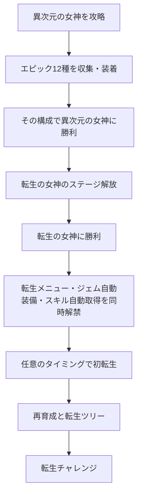

# 転生・転生チャレンジ・実績システム企画

2026-10-17作成。**企画検討中・未実装。実装着手と採用の判断は保留。**

ユーザーの原案を土台に、現行の装備・ジェム・経験値・自動周回との接続を補った企画書。本文の「指定」は今回の原案、「推奨案」「仮値」「候補」は追加提案であり、採用済みのゲーム仕様ではない。企画書の保存・コミットは実装開始を意味しない。

## 1. 企画の軸

初回は世界の奥まで進み、エピック12種を揃えて隠しボスを発見する。転生後は同じ育成を短時間で組み直し、前回とは違う強化先や制約を選んで、次の転生をもっと効率よく進める。

- 初回攻略の達成感は、転生を知らない状態で成立させる。
- 転生の価値を「数値が増える」「再構築が楽になる」「違う攻略ができる」の3つで作る。
- 自動化の基本機能は転生解禁と同時に渡す。手作業を何周も要求してから便利機能を売る構成にしない。
- ツリーの充実は、効果の異なる枝・節目・組み合わせで作る。同じ倍率だけを延々と並べない。
- 実績は名誉と案内が中心。必須の能力報酬や転生ポイントの供給源にはしない。

### 現行仕様との接点

| 現行の事実 | 本企画での扱い |
| --- | --- |
| エピックは6職×武器・防具の12種。専用容量を使い、各部位1個 | 解放判定は「12個所持」でなく、12部位への合法な同時装着 |
| 異次元の女神は制限180秒。エピック完成構成では約20.9秒の試運転記録 | 新ボスは全エピック前提の別基準で調整。既存女神を強化して相殺しない |
| Lv上限100、経験値はレベル内の正規化進捗 | 転生後も上限100を維持。経験値強化は指数の加算で扱う |
| 女神強化で1職あたり追加SP60、Lv.100の基礎SPと合わせて160 | 転生のSP倍率と装備由来SPの適用範囲を分離する |
| 森10で装備強化自動取得を解放 | 転生後は解放と設定を保持し、最初から利用可能にする |
| 報酬はクリア時にまとめて付与。育成は次の戦闘開始時に反映 | 自動取得・自動装着も同じ境界で処理する |

根拠：[エピックと女神強化](../implementation/epic-gems.md)、[異次元の女神](../implementation/extradimensional-goddess.md)、[自動装備強化](../implementation/auto-gear-and-unlocks.md)、[報酬・性能改善](../implementation/run-flow-and-performance.md)、[バランス方針](../policies/balance-policy.md)。記録の約20.9秒から新ボスのHPを単純比例で決めることはできない。

## 2. 解放までの流れと秘匿

### 指定に基づく解放条件

1. 全6職の武器・防具に、それぞれ対応するエピックを装着する。
2. その構成で異次元の女神に勝利し、転生の女神を解放する。
3. 転生の女神を倒した時点で、転生メニューと2種類の自動化を解禁する。初転生を待たない。

判定は**戦闘開始時に固定した実際の構成と、その戦闘の勝利**で行う案を推奨する。戦闘中の装着変更は次の周から反映される現行仕様と揃える。12種の重複なし、職・部位・容量の合法性を確認し、戦士用12個の所持や勝利直前のメニュー変更では達成にしない。全員生存や薬禁止は条件に追加しない。

解放は永続。以後、転生の女神への入場や転生のたびに12種の再装着を要求しない。エピック再収集は、その周の戦力を仕上げるための選択とする。

### 表示段階

| 状態 | 表示するもの | 伏せるもの |
| --- | --- | --- |
| 異次元の女神をまだ発見していない | 到達済みの通常コンテンツと実績 | 女神名・姿・関連収集物・転生関連の全項目 |
| 異次元の女神に遭遇済み、エピック未発見 | 発見済みの女神情報 | エピック12種の条件、転生関連の全項目 |
| エピックを初入手 | エピック収集実績、12部位装着で女神に勝つ実績の条件 | 達成後の報酬、転生機能の存在 |
| 12部位装着で女神に勝利 | 転生の女神のステージ、発見演出 | 転生メニュー、転生ツリー、自動化の解禁予告 |
| 転生の女神に勝利 | 転生と自動化の解禁演出・メニュー | 未解放の試練詳細など |

実績のヒント文は「全6職の武器・防具にエピックを装着して、異次元の女神に勝利」。実績名は仮に「十二の星の証」。条件を示しても、転生・リセット・次の機能には言及しない。

「転生の女神」というボス名は原案どおり、本人のステージ解放後に表示する。ただし、その名前から先の機能を説明する文、未解放の転生ボタン、ツリーの影、転生ポイントの通貨欄は撃破前に出さない。

秘匿対象はメニューだけでなく、実績総数・達成率の分母・資料館・検索候補・ツールチップ・通知履歴・アクセシビリティ用ラベルにも及ぶ。隠し項目の件数から存在がわからないようにする。既存セーブで条件を満たしている場合、過去の構成付き勝利記録がなければ、所持品だけから達成を推測せず再挑戦を必要とする。

## 3. 転生の女神

### キャラクターと戦闘の方向

指定：金髪で、アホっぽいギャグテイスト。現代兵器・SF兵器を次々に持ち出し、最大の見せ場は大型トラックによる突進。

推奨するキャラ像は「物騒な道具の扱いに妙に自信があるが、毎回どこか抜けている女神」。重火器の反動でよろける、巨大砲の充電完了に本人が驚く、トラック爆発後に煤だらけで着地する、といった動きで性格を伝える。長い台詞を必須にせず、シルエットとリアクションで笑えるようにする。

ステージ名は仮に「女神の配送センター」。女神本体、兵器、トラックは既存戦闘画面のドット絵テイストに揃える。危険範囲の予告以外の弾・爆発・煙・タイヤ痕・光は画像素材を使う。今回は画像制作も行わない。

| 行動 | 役割・見た目の案 | 攻略上の区別 |
| --- | --- | --- |
| 通常射撃 | 大きすぎる機関銃を抱えて短い連射 | 小刻みな被害。連射全体の被害予算で調整 |
| ロケット配送 | ロケットランチャーから弾を発射 | 着弾地点を先に表示。爆風の重複上限を設定 |
| SF砲 | 背丈を超えるレーザー砲を設置・充電 | 固定した直線予告。行動妨害の対象 |
| 空からのお届け | SFドローンから数か所へ投下 | 全員を同時に拘束せず、範囲を判別可能にする |
| 大型トラック | 乗車→空ぶかし→突進 | 長い予備動作と妨害ゲージ。中断で爆発・隙 |

HP50%以下でSF兵器の比率を上げ、トラックの存在感も増す案。別HPへの交換や大きな無敵時間で180秒を削る構造は避ける。

### トラックの状態遷移

「待機中にトラックに乗る」は、大技の準備・待機区間で乗り込む動きとして整理する。

1. **呼び出し・乗車**：画面内の所定位置にトラック。女神が乗り込む。目安1.5〜2秒。
2. **発進待機**：空ぶかしとライト、エンジンの振動。突進の向き・範囲と妨害ゲージを固定。目安3〜4秒。
3. **中断成功**：トラックがその場で爆発。女神が飛び出し、煤だらけで2〜3秒の隙。爆発は味方への罰にしない。
4. **中断失敗**：予告した方向へ突進。1人につき本体衝突1回まで。画面外で判定を継続しない。
5. **復帰**：急停車または乗り捨て、女神が通常行動へ戻る。次の行動へ予約を持ち越さない。

トラックはまず女神の大技演出・当たり判定として扱い、独立した敵・HP・報酬は持たせない案を推奨する。攻撃対象が分かれて火力や妨害が吸われる事故を避けられる。女神撃破・戦闘中断・時間切れ時には、車両と予約攻撃をまとめて清掃する。

既存の行動妨害と抵抗成長を使い、毎回必ず止まるだけの大技にしない。初回の待機時間と抵抗値は全エピック構成で測定して決める。中断の報酬は安全と攻撃機会を基本とし、自爆ダメージを強さの前提にしない。

### 難度と報酬

- 指定：エピック12個装着で、3分ぎりぎり程度の強さ。
- 推奨する基準構成：全6職Lv.100、通常地域・女神装備を完成、エピック12種、薬なし。通常ジェムとスキル配分も固定した合法な検証構成を用意する。転生強化は0。
- 仮の合格目標：固定30配置で30勝、撃破時間中央値170〜175秒、最長180秒以内。HP0到達が時間内なら撃破演出中の時間切れで負けない。
- 最適な通常ジェムをさらに積んだ構成まで一律に180秒へ揃えない。最適化と育成の余地を残す。
- 最大単発被害は既存方針の51%以内。連射・爆風などの連続被害もまとめて検査する。女神戦は通常地域の45〜150秒目安とは別の特殊基準とする。
- 主報酬は転生・自動化の永続解禁。新たな必須素材や第2のエピック収集をここで追加しない。通常のゴールド等は周回価値と合わせて後で決める。

「ぎりぎり」と「配置運で負けない」の両立が難しい場合、最長時間の合格を優先し、中央値に余裕を作る。既存記録からの推定だけで成立を宣言しない。

## 4. 転生でリセットするもの・保持するもの

「持ち物とレベルをすべてリセット」「解放したシステムはそのまま」を、**その周の育成状態**と**永続の発見・利用権**に分ける。以下は境界を具体化する推奨案。

| 対象 | 転生後 |
| --- | --- |
| 全キャラのレベル・経験値進捗 | Lv.1・進捗0に戻す |
| ゴールド・端数、素材、薬、ジェム、破片、女神素材 | すべて0。装着中・保護中も含む |
| 武器・防具・女神装備の取得ノード | すべて未取得。専用容量や装備由来SPも失う |
| スキル取得ランク・使用済みSP | すべて戻す。初期無料行動のみ再設定し、Lv.1と永続強化からSP予算を再計算 |
| 今周のステージクリア・初回報酬受取記録 | リセット。森1から進行し直す |
| 過去に加入した仲間 | **全員をLv.1で初めから使える案を推奨**。再加入待ちと加入演出は省く |
| 機能・レシピ・装備ページ・特殊ボスの解放 | 保持。利用権は残すが、今周の到達・購入条件は別途必要 |
| スキル・装備・素材・敵などの発見記録 | 保持。どこに何があるか、必要条件がわかる |
| 転生機能・自動化・実績・資料館・チャレンジ解放 | 保持 |
| 転生ポイント・転生ツリー・試練の恒久進行 | 保持 |
| 自動化の優先度・プリセット・解体設定・表示設定 | 保持。ただし消えたジェム個体IDへの固定指定は解除 |
| 戦闘中の未受取報酬・召喚・妨害・周回予約 | 破棄。戦闘終了を待つか転生確認で中断を明示 |

発見記録が残っていても、森1から終盤へ直接飛べる状態にはしない。見えている未到達ステージには今周の到達条件を表示する。特殊ボスも「発見済み」と「今周入場可能」を分ける。転生の女神は、今周の異次元の女神を倒せば入場でき、12種装着の解放儀式は繰り返さない案。

仲間をLv.1から使える案では、現行の加入時Lv・装備・取得済みスキルの補填を再発動しない。再度Lv.20〜40に引き上げる抜け道を作らない。仲間全員での序盤短縮は転生の便益として評価する。

転生直後の所持品は0。ただし後述のツリーによる「必要素材の軽減」「自動化」「報酬倍率」で立ち上がりを速くする。ジェムや完成装備を隠れて持ち越す機能は基本案に入れない。

### 安全な確定操作

転生画面に、獲得ポイント、失う物、保持されるもの、次周の主な倍率をまとめ、確定前の1画面で確認できるようにする。初回はリセット内容を十分に説明し、2回目以降も確認を残す。自動転生は初期実装の対象にしない。

確定処理は「今周報酬の確定→ポイント加算→育成初期化→新周開始待ち」を1回だけ成立させる。同じ確定操作の連打・再読込でポイントが増えないこと、初期化だけ行われないことを保存単位で保証する。取り消しなら一切変えない。転生前バックアップ1世代の保持も候補とし、復元時は通貨・所持品を含むセーブ全体を戻す。

## 5. 転生ポイントと周回の価値

### 獲得原則の推奨案

- 転生の女神を最初に倒した直後の周も、到達分のポイントを持って初転生できる。倒した瞬間の通常報酬としては配らない。
- 転生は任意。ただし浅すぎる周は獲得0で、確認時に明示する。
- 基本ポイントは**今周の最高到達段階**から決める。同じボスを何回倒しても直接加算しない。
- 過去最高到達ではなく、毎周の到達を評価する。昔の女神撃破記録だけで即転生を繰り返しても得られない。
- 所持ゴールド、素材、ジェム数を直接ポイントへ変換しない。ドロップ強化が転生報酬へ直結する二重の加速を避ける。
- 有効転生回数は「基本ポイントが1以上の周を精算した回数」。0ポイントの連打は試練解放の10回に数えない。

### 報酬カーブのたたき台

以下は比較計算用の仮値。取得済みの到達項目のうち最大値1つを使う。表の値を全部合算しない。

| 今周で達成した段階 | 基本ポイントB・仮値 |
| --- | ---: |
| 通常ステージ50未満 | 0 |
| 通常50 / 60 / 70 / 80 / 90 / 100 | 10 / 20 / 35 / 55 / 80 / 110 |
| 次元の門 | 25 |
| 混沌の門 | 140 |
| 異次元の女神 | 180 |
| 転生の女神 | 240 |

通常の端数ステージは、まず上記の10段階の節目で評価する案。毎ステージの細かな加点は実測後に判断する。

獲得は `floor(B × C)`。通常周はC=1、チャレンジ達成時は後述の倍率。初転生の仮240ポイントでは、1〜2系統の節目か、複数系統の低ランク強化を選べる費用感にする。

### 数値決定で優先すること

「毎回転生の女神まで行く」も「最初の報酬地点で即転生」も唯一の正解にしない。前半の高速周回、エピック再構築、試練突破で異なる利点を作る。固定の待機時間による報酬や短時間ペナルティを先に入れず、到達報酬と実際の所要時間で調整する。

測定単位は、戦闘時間だけでなく育成・装着・リザルト・素材稼ぎを含む1周全体。毎回の手操作数も測る。浅い周だけが大幅に得なら、深い到達の報酬や再構築速度を調整する。過去実績から永久にポイントを配るだけの方式にはしない。

## 6. 転生ツリー

### 全体構成

**中心4ノード＋8系統×8ノード＋系統間8ノード＝76種類**を設計の骨格とする。倍率系の一部を複数ランクにし、取得回数はさらに増やす。これは充実度の目安であり、初回から76種類を完成実装する約束ではない。

中心は「転生」「記憶」「自動化」「試練」。前3つは転生解禁時の無償ノードで、既存の保持・自動化を説明する入口。試練は後述の条件で開く。自動装備・自動取得の基本機能を有料ノードに戻さない。

各系統は、入口から2本の枝に分かれ、片側を進めても別側を全部買う必要はない。3段程度ごとに使い方が変わる節目を置き、最後に系統間ノードへ接続する。すべての系統を1本の巨大な必須直列にしない。

UIは系統ごとに色とアイコンを分け、パン・ズーム・検索・購入可能ノードへの移動を用意する。未解禁の試練詳細は隠す。効果は短い名称と値を中心に、前提・費用・次のランクをホバーで表示する。

### 効果と計算の共通ルール

| 効果 | 推奨する扱い |
| --- | --- |
| ドロップ数倍率M | トレハンと独立した乗算枠。まず素材・ジェムを対象。ゴールドは別倍率 |
| 経験値 | 指数をx加算し、倍率の意味は3^x。1ランクで育成想定ステージが1つ先になる |
| 与ダメージ・最大HP | それぞれ転生ツリー内の加算を1つの倍率へ集約し、通常育成へ1回だけ適用 |
| トレハン | パーティー共通の基礎加算。キャラ6人へ付けて6倍にしない |
| SP倍率 | レベル由来SPだけを対象。装備由来SP60は乗算しない案 |
| 容量・割引 | 既存の方向・共通・職専用容量を区別。職専用容量を共通容量で代替しない |

与ダメージ倍率は、反射・継続ダメージ・召喚・追加Hitを含め、各最終ダメージイベントへ1回。親攻撃で掛けた倍率を複写先で再度掛けない。最大HP倍率は基礎・装備・スキルの集計後へ1回。回復・バリアのHP参照はその結果を使う。敵の攻撃を現在HP比例へ変えて強化を打ち消さない。

### ドロップ倍率の具体化

対象報酬の基本確率をp、転生のドロップ数倍率をM、パーティートレハンをH（50%なら0.5）として、`q = p × M × (1 + H)`。整数部分を確定個数、端数を追加1個の確率とする。特殊ステージ固有のジェム倍率も別枠で1回だけ掛ける。

| 基本確率p | M | H | 結果 |
| ---: | ---: | ---: | --- |
| 100% | 2 | 0% | 2個確定 |
| 100% | 2 | 50% | 3個確定。原案の例はこの条件 |
| 30% | 2 | 50% | 90%で1個。レア素材まで常に3個にはしない |
| エピック1% | 2 | 50% | 3%で1個 |

抽選が成功した個体をM個に複製する方式にはしない。ジェムは各個体を新規生成し、ID・品質・能力を独立に持たせる。低倍率でのレア度間の排他的抽選と、高倍率での100%超過は現行の端数区間方式を維持して拡張する。複数レア度の合計を100%に丸めない。

適用外は、転生ポイント、実績、機能解放、初回の固定配布、制作・変換・解体の出力。ゴールドは従来のトレハンに専用ゴールド倍率を掛ける。生産物へドロップ倍率を重ねる無限変換を作らない。

経験値は `有効ステージ = 報酬ステージ + x` として現在の正規化進捗へ接続し、正の指数の累乗を計算しない。Lv.100上限、表示％、獲得量が3^(-20)以下なら0を維持する。経験値倍率は敵・装備・ジェムの地域Lvを変えない。

SPの仮式は `floor(L × (1 + a)) + b × floor(L / 10) + 装備SP`。Lは現在Lv、aはSP倍率の追加分、bは10Lvごとの追加数。例：L=100、a=0.2、b=1、装備SP60なら190。SPをイベントごとに累積加算せず総予算を再計算し、振り直し・減算・再読込で増殖させない。

### 8系統のノード候補

以下の数値はすべて初回比較用の仮値。「上限」はまず設ける安全側の案で、全取得時の測定で確定する。各行は1種類のノード。複数ランクは同じノードの追加取得として扱う。

| ID | 系統 | 名称案 | 効果案 |
| --- | --- | --- | --- |
| H1 | 収穫 | 小さな実り | ドロップ数倍率の追加分＋0.1、5ランク |
| H2 | 収穫 | 豊穣 | 同＋0.5、1ランク |
| H3 | 収穫 | 大豊穣 | 同＋1.0、1ランク。序盤の到達目標 |
| H4 | 収穫 | 幸運の基礎 | パーティートレハン＋10%、5ランク |
| H5 | 収穫 | 金運 | ゴールド＋10%、5ランク |
| H6 | 収穫 | 結晶の収穫 | 地域結晶の報酬数＋25%、2ランク |
| H7 | 収穫 | 希少の兆し | レア素材の報酬数＋25%、2ランク |
| H8 | 収穫 | 豊穣の輪 | 通常地域の大ボスに限りドロップ数倍率の追加分＋1 |
| E1 | 成長 | 既視感 | 経験値指数＋1、3ランク |
| E2 | 成長 | 鮮明な記憶 | 同＋1、3ランク。別枝から接続 |
| E3 | 成長 | 成長の極意 | 同＋1、4ランク。成長系統の節目 |
| E4 | 成長 | 平時の鍛錬 | ステージ1・5の経験値指数＋1 |
| E5 | 成長 | 追い上げ | パーティー最高Lvより低いキャラの指数＋1。最高Lvまで |
| E6 | 成長 | 集中鍛錬 | Lv.90未満のキャラの経験値指数＋1 |
| E7 | 成長 | 短い助走 | 通常ステージ30以下で経験値指数＋2 |
| E8 | 成長 | 長い記憶 | 通常ステージ80以上で経験値指数＋2 |
| B1 | 戦闘 | 戦意 | 与ダメージ＋10%、5ランク |
| B2 | 戦闘 | 武の記憶 | 通常攻撃の与ダメージ＋10%、3ランク |
| B3 | 戦闘 | 技の記憶 | アクティブの与ダメージ＋10%、3ランク |
| B4 | 戦闘 | 破陣 | 行動妨害力＋5%、3ランク |
| B5 | 戦闘 | 快調 | 再使用回復速度＋5%、3ランク |
| B6 | 戦闘 | 精密 | 会心率＋2%、3ランク。最終上限は既存規則に従う |
| B7 | 戦闘 | 猛攻 | ボス以外への与ダメージ＋30% |
| B8 | 戦闘 | 決戦 | 大ボス・特殊ボスへの与ダメージ＋20% |
| V1 | 生存 | 命の器 | 最大HP＋10%、5ランク |
| V2 | 生存 | 耐久 | 防御力＋5%、3ランク |
| V3 | 生存 | 息継ぎ | MP回復＋5%、3ランク |
| V4 | 生存 | 霊泉 | 最大MP＋10%、3ランク |
| V5 | 生存 | 守りの記憶 | バリア量＋5%、3ランク |
| V6 | 生存 | 癒しの記憶 | 回復量＋5%、3ランク |
| V7 | 生存 | 早期回復 | ウェーブ間回復＋10%、2ランク。現行回復仕様を確認して採否判断 |
| V8 | 生存 | 立て直し | 1戦1回の致死回避候補。強すぎれば採用せず別効果へ |
| S1 | 技能 | 技の蓄積 | レベル由来SP倍率＋0.1、3ランク |
| S2 | 技能 | 十年の研鑽 | 10LvごとのSP＋1、3ランク |
| S3 | 技能 | 技能計画 | 自動取得プリセット枠＋1、3ランク |
| S4 | 技能 | 習得目標 | スキルごとの自動取得上限ランクを指定 |
| S5 | 技能 | 積立 | 指定スキルのためのSP予約を任意で設定 |
| S6 | 技能 | 序盤構成 | 今周の到達段階でプリセットを切り替える |
| S7 | 技能 | 決戦構成 | 特殊ボス用の手動適用プリセット枠 |
| S8 | 技能 | 熟練 | SP倍率の追加分＋0.2、1ランク |
| G1 | 宝石 | 容量の記憶 | 各部位の共通容量＋25、4ランク |
| G2 | 宝石 | 攻勢の器 | 武器の攻撃容量＋50、3ランク |
| G3 | 宝石 | 守勢の器 | 防具の防御容量＋50、3ランク |
| G4 | 宝石 | 補助の器 | 各部位の補助容量＋25、3ランク |
| G5 | 宝石 | 工房の節約 | 制作素材費−5%、3ランク。循環収支の検証が条件 |
| G6 | 宝石 | 研磨の節約 | 地域Lv強化費−5%、3ランク |
| G7 | 宝石 | 宝石計画 | 自動装備プリセット枠＋1、3ランク |
| G8 | 宝石 | 契約の再構築 | 指定済みのエピックを順番に自動制作。個数上限・素材予算の事前設定が必要 |
| R1 | 再走 | 結果の早送り | 既読リザルトを短縮。戦闘演出の派手さは保持 |
| R2 | 再走 | 待機の短縮 | 自動周回の待機時間を短縮。完全省略はメニュー操作を妨げない設計が条件 |
| R3 | 再走 | 進行の計画 | 「次へ・稼ぎ・再挑戦」の条件付きルートを保存 |
| R4 | 再走 | 育成待ち | 指定メイン装備・Lvまで稼いでから進む |
| R5 | 再走 | 地域の節約 | メイン装備素材費−5%、3ランク。各素材0にはしない |
| R6 | 再走 | 全体の節約 | メイン装備ゴールド費−5%、3ランク |
| R7 | 再走 | 挑戦予約 | 任意ON時のみ、条件が改善したら敗北ステージへ再挑戦 |
| R8 | 再走 | 道の短縮 | 既攻略地域の1→5→10進行候補。中間クリア条件・報酬・装備ゲートの別設計が必要 |
| T1 | 試練 | 硬殻の枝 | 敵HP制約の追加ランク解放 |
| T2 | 試練 | 猛威の枝 | 敵火力制約の追加ランク解放 |
| T3 | 試練 | 渇きの枝 | 回復・MP制約の追加ランク解放 |
| T4 | 試練 | 封印の枝 | ジェム制約の追加段階解放 |
| T5 | 試練 | 倹約の枝 | 装備サブ・ユニーク制約を解放 |
| T6 | 試練 | 未熟の枝 | SP制約を解放 |
| T7 | 試練 | 複合試練 | 同時選択枠を3→4へ拡張 |
| T8 | 試練 | 大試練 | さらに4→5枠、上位目標解放 |

支払いに見合うか疑わしい便利機能は標準搭載へ移す候補。安全性・基本的な情報表示・ジェム保護はツリー購入の対象にしない。G8は対象・上限・予算をユーザーが設定してONにした場合のみ作動し、不足素材の案内自体は無償にする。R8は報酬を無償取得させるノードではなく、経路短縮として成立する場合だけ採用する。

### 系統間の8ノード候補

| 接続 | 効果案 |
| --- | --- |
| 収穫×成長 | 稼ぎルート用プリセット。既存の倍率にさらに無制限の乗算は足さない |
| 成長×技能 | Lv到達ごとの取得計画を複数保存 |
| 技能×戦闘 | 特殊戦用の構成比較を保存。戦闘中の能力は変更しない |
| 戦闘×生存 | 攻撃・耐久の転生強化配分を転生時に一括変更 |
| 生存×再走 | 敗北原因と再挑戦条件をルート設定へ反映する支援 |
| 再走×収穫 | 素材予算に応じて1・5・10の稼ぎ先を選択 |
| 宝石×技能 | ジェム条件とスキル配分を1組のプリセットとして保存 |
| 宝石×試練 | 「先行試練」：有効転生3回以降、重めの費用で10回を待たず試練を解放 |

### 費用・振り直し

入口は仮10〜30、枝は40〜120、節目は160〜400、終端・系統間は500以上から比較する。同じノードのランク費用は増加させる。初転生で全系統を完成させず、少なくとも1つ「次の周が明確に変わる」選択を買えるようにする。各効果の費用は、ポイント毎時と初回の選択例を測ってから確定する。

転生ツリーの購入・無料の振り直しは、転生精算後〜次周開始前を基本とする。「先行試練」の恒久解放ノードだけは取得と支払いを保持し、振り直し対象から除外する案。周回中は閲覧可能。途中で倍率を買い替えて報酬だけ受け取り、戦闘時に別構成へ戻す運用を避ける。精算時の報酬は今周開始時の構成で固定する。総獲得ポイント＝使用済み＋未使用を常に一致させる。

## 7. スキル自動取得

指定：転生解禁時に機能解禁。スキルごとに7段階の優先度。同じ優先度では高いレベルのものを優先する。

### 基本ルールの推奨案

- 優先度は**1が最高、7が最低**。利用しない設定は優先度とは別のON/OFF。
- 「高いレベル」は**スキルの解放Lv**として定義する。現在取得ランクを指す案ではないため、採用前に確認する。
- 比較順は、優先度の数値が小さい順→解放Lvが高い順→保存された手動順または固定ID順。同じ条件なら再読込でも同じ取得結果。
- 購入可能な1ランクを取り、候補を更新して繰り返す。同条件なら上位候補を先に上限まで育てる。未解放・前提不足・最大ランク・対象外は飛ばす。
- 高優先度スキルがまだ解放されていなくても、標準ではSPを貯めず取得可能な候補へ使う。SP予約は高度設定の候補。
- 前提スキルは勝手に優先度を変えない。必要な前提がOFFなら停止理由をアイコンとホバーで示す。
- 手動取得・減算・振り直しと競合させない。編集画面を開いているキャラの自動処理を止め、閉じた後にまとめて再評価する。手動で下げた直後に買い直す事故を防ぐ。

| 分類 | 初期優先度 |
| --- | ---: |
| アクティブ | 1 |
| 攻撃系パッシブ | 2 |
| その他パッシブ | 3 |
| スキル個別強化 | 4 |
| 予備 | 5〜7 |

通常攻撃の有料強化も初期優先度1へ含める案。無料の基本行動は購入対象外。攻撃系パッシブは表示名の文字列で判定せず、定義タグで分類する。複合効果は初期分類を固定し、個別変更を許す。

SP増加、レベル上昇、前提の取得・解除、設定変更だけを再評価の契機にする。毎フレーム全スキルを調べない。Lvがまとめて上がった場合は合算後に1回処理する。変化のないチェックを繰り返さない。

自動でプリセットを切り替える場合は、以後の取得方針だけを変更する。取得済みランクを勝手に減算して再配分しない。構成の振り直しを伴う適用は、対象と変更量を見せた手動操作にする。

## 8. ジェム自動装備

### ユーザーが指定する条件

基本機能は転生の女神撃破と同時に解禁。初回は設定を確認してONにする導線とし、所持ジェムを勝手に入れ替えない。自動装備と自動解体のON/OFFは別。

- キャラ・武器／防具ごとの優先効果。例えば「攻撃→再使用回復→MP回復」、支援職は「回復・補助→MP回復」など。
- 数値優先か容量効率優先か、最低レア度、対象から除外する効果、エピックの優先。
- 各キャラ・部位を埋める順序。1個の共有ジェムを複数箇所で取り合わないために必須。
- 現在の装着を固定するロック。解体保護とは別に扱う。保護した未装着ジェムは装備候補にできるが、固定装着は動かさない。
- 明示した場合のみ他キャラからの移動を許す。標準は未装着と、その部位自身のジェムから選ぶ。

基準プリセットは用意するが、最適編成を保証する機能とはしない。優先条件どおりの安定した近似選択と、手動構成の固定を重視する。複数方向容量・共通容量・専用容量・割引・職制限は手動装着と完全に同じ判定を使う。

### 計算方法の推奨案

1. 個体ごとの効果・職・部位・容量を1回解釈してキャッシュ。設定ごとの評価も版番号を付けて再利用。
2. クリアで得たジェムをバッチ登録し、職・部位・優先効果の索引を更新する。1個ずつ全装備の組合せを探索しない。
3. 影響する部位だけをdirtyにする。新規ジェムが関係しない職や、設定が変わっていない部位は再計算しない。
4. 各部位で条件ごとの上位候補を絞り、現在の装着・固定品・容量の異なる候補も必ず含める。単純な上位件数だけでは、小型の組合せを落とすため、容量帯・効果別に候補枠を分ける。
5. 優先順と容量を使う貪欲法＋1〜2個の入替探索を候補にする。全個体を使った組合せの総当たりは行わない。
6. 変更案を全体で検証してから一括反映。同点なら現在装着を維持し、入手順とIDで安定させる。職間のジェム往復を防ぐ。

候補数・探索回数・処理時間の上限は実測で決定する。高レア大量ドロップでも描画フレームを長時間止めないよう、処理を分割し、次の戦闘開始前に必要分を確定する。上限に達したら合法な現在構成を残し、半端な装着状態を保存しない。

容量増加・割引変更・スキル設定変更・個体削除・設定変更・セーブ切替・転生でも関係するキャッシュを無効化する。完成後の主要目標は「1個入手ごとの全個体×全12部位再探索が発生しないこと」。単に速いPCで動いたことを性能合格にしない。

### クリアから次の戦闘までの順序

報酬抽選・付与→装備強化自動取得→SP総予算とスキル自動取得→容量等を確定→ジェム自動装備→保存→次戦闘の構成固定。

自動解体の既存設定を先に適用すると、欲しい候補を捨てる危険がある。推奨は「解体候補を一時保留→自動装備で採用・保留する個体を除外→残りだけ自動解体」。装着・保護・手動ロック品は常に除外する。解体候補も含めてクリア精算を1回だけ成立させ、再読込で報酬や破片を二重取得させない。

自動装備がOFFのときは既存の自動解体を維持する。プレビューと採用理由は設定画面に置き、ジェムの効果ツールチップへ説明文章を増やさない。

## 9. 転生チャレンジ

### 解放と周の始め方

指定：ある程度転生を繰り返すか、ツリーノード取得で解放。特殊なデバフや敵強化を選び、難度に応じて転生ポイントが増える。通常転生に戻ることもできる。

推奨は**有効転生10回で無償解放**。早く挑戦したい人向けに、有効転生3回＋系統間ノード「先行試練」の経路を用意する。どちらかを満たせば永続解放。先行試練は恒久解放ノードとして取得と支払いを保持し、無料振り直しの対象外にする。購入前にその点を明示し、10回を待つ無償経路も常に選べるようにする。

転生精算後、通常周か試練周を選ぶ。試練は目的地・制約・倍率を開始前に固定し、途中変更しない。利用している永続強化は残り、制約で指定された部分だけを一時無効化する。自動化・発見記録・実績まで奪う制約は基本案に入れない。

目標はまず「通常100」「混沌の門」「転生の女神」の3段階を候補とする。今周に目標を達成した後の転生で倍率が有効になる。転生の女神を目標にしても、12種装着の解放条件を再要求しない。

### 制約ツリーの案

各系統内は段階的、系統間は独立。根を広く開け、転生ツリーで追加段階・系統・同時選択枠を増やす。初期は最大3系統。自動化の便利さを保ったまま、編成や強化の重点が変わる内容を優先する。

| 系統 | 段階1 / 2 / 3の仮値・内容 | 難度点の仮値 |
| --- | --- | --- |
| 硬殻 | 敵HP＋25% / ＋60% / ＋120% | 1 / 3 / 6 |
| 猛威 | 敵与ダメージ＋15% / ＋35% / ＋70% | 1 / 3 / 6 |
| 渇き | 味方の回復量×0.8 / 0.65 / 0.5 | 1 / 3 / 5 |
| 枯渇 | MP回復量×0.8 / 0.6 / 0.4 | 1 / 3 / 5 |
| 宝石封印 | エピック無効 / レジェンダリー以上無効 / 全ジェム無効 | 3 / 7 / 12 |
| 倹約 | 装備サブ無効 / サブとユニーク無効 | 4 / 8 |
| 未熟 | レベル由来SP×0.8 / 0.65 / 0.5 | 2 / 4 / 7 |
| 遅学 | 経験値指数−1 / −2 / −3 | 1 / 3 / 5 |

初期の試練には硬殻・猛威・渇き・宝石封印の低段階を優先。MP・SP・経験値の複合封鎖は、戦略より放置時間だけを増やす恐れがあるため後回し。トレハンやドロップ低下も同じ理由で初期候補から外す。

目標×制約の組合せごとに攻略可能性を確認する。特に全エピック前提の転生の女神へジェム封印を課す設定は、成立を確認できるまで初期解放しない。火力制約も、標準構成で既存の最大単発被害51%枠を超えない範囲から採用し、表の倍率を優先して被害基準を破らない。

上位段階は置き換え。例えば全ジェム無効の12点に「エピック無効3点」「レジェ以上無効7点」を重ねて22点にはしない。同じ効果を実質無効化する組合せや、目標に関与しない制約は重複加点しない。

### 報酬と達成

難度点合計をQとして、仮倍率は `C = 1 + 0.10 × Q`、初期上限3倍。Q=10で2倍、Q=20で3倍。乗算で制約ごとの倍率を掛け続ける方式にはしない。系統追加・上限拡張は、実際の負荷と周回効率を見て行う。

制約の初回達成は称号・実績・記録を基本とし、さらにポイント倍率を恒久加算する仕組みは初期案では入れない。制約の点数は名称の厳しさで決めず、構成別の到達率・所要時間で調整する。「普段使わない要素を封じるだけで大幅増益」になる場合、点数・対象・組合せを見直す。

報酬の基礎Bは今周の到達で計算。目標未達成の転生・放棄は試練報酬0とし、開始前に明記する。目標達成後は結果を保留したまま次の到達を狙うこともできる。敗北だけでチャレンジ失敗・周の削除にはしない。

### 放棄とテーマ

「試練をあきらめる」は確認後にその周を終了し、ポイント0で通常周の開始待ちへ戻す。すでに所有する転生ポイント・ツリー・解放・実績は失わない。**同じ周のデバフだけ外して続行する方式にはしない**。難度を軽くしてから高倍率を受け取る抜け道を防ぐ。

試練中は、メニューの緑基調を暗い赤・朱へ変更し、固定の試練アイコン・選択制約・目標進捗・倍率を表示する。色だけに頼らない。敵味方や危険予告の色まで一律に赤へせず、通常戦と同じ視認性を保つ。転生・放棄・読込後もテーマを正しく復元する。

## 10. 実績システム

### 基本方針

名誉報酬、進行ガイド、遊びの記録。基本報酬は実績バッジ・日付・必要なら称号。ダメージやドロップの全実績ボーナスは設けない。転生しても解除済み実績は保持し、毎周同じ通知を出さない。

| 分類 | 実績案・判定単位 |
| --- | --- |
| ステージ | 各地域の1・5・10を初クリア。特殊ステージも個別に初クリア |
| 仲間 | 各職の初加入、全6職加入 |
| ジェム | レア・ユニーク・レジェンダリー・エピックの各初入手。制作でも入手として数える |
| エピック収集 | 12種の初発見コンプリート。12個所持とは分ける |
| 装備の入口 | 各装備ツリーのメイン10、ユニーク初取得 |
| 装備の完成 | 各キャラ・地域・武器／防具ごとのメイン完成、ユニーク全取得、ツリー全取得 |
| 装備完成数 | 各キャラの武器と防具を別々に、完成ツリー数1・5・10・11 |
| 完全装備 | キャラごとに武器11本・防具11本完成、さらに全6職の完全完成 |
| 機能の利用 | アイテム変換、ジェム生成、ジェム解体を初利用 |
| 隠し条件 | 全12部位にエピック装着で異次元の女神に勝利 |
| 転生導線 | 転生の女神を初撃破、初転生 |
| 転生の記録 | 有効転生3・10・25回、各系統の節目取得など。解禁後のみ表示 |
| 試練 | 初達成、難度点の節目、各制約系統の初達成。解禁後のみ表示 |

装備の「11本」は**通常10地域＋女神ツリー1本**と定義する。通常ツリーは100ノード、女神ツリーは41ノードなので、同じノード数を要求しない。女神ツリーのメイン・ユニークの分類は現行形と異なるため、メイン10実績を無理に適用せず、完成実績を適用する。

「それぞれのコンプリート」は、上表のメイン完成・ユニーク完成・ツリー全取得へ分ける案。細かい実績を全件横並びにせず、「職→武器／防具→地域」のコレクション帳として折りたたむ。個別バッジと大きな節目の通知を分け、転生後の再達成で画面を埋めない。

### 転生をまたぐ収集記録

- エピック12種の収集など、発見の実績は生涯記録。転生で個体が消えても保持。
- 装備の完成数は、完成したツリーIDを生涯の集合として保存。同じ森ツリーを11周完成させても11本にはしない。
- 「全6職の武器・防具完全完成」は、まず各固有ツリーの生涯完成記録を揃える方式を推奨。同一周で全てを同時保有させる実績が欲しければ、別の上級名誉実績にする。
- 「12部位装着で女神に勝利」は実際の1戦の同時装着が必須。生涯で別々に装着した記録を足さない。
- システム利用は実行成功で解除。画面を開いただけや、変換の失敗では解除しない。自動処理による解体も初利用として認める案。

### ネタバレ防止と案内

既知カテゴリの未発見対象名は「???」、絵は共通の影。異次元の女神など秘匿コンテンツの固有名・アイコン・達成文は発見段階まで隠す。転生の項目は転生の女神撃破まで、試練の詳細は試練解禁まで、行そのものを出さない。

「次のおすすめ」は最大3件程度。到達済みシステムの初利用、今進んでいる地域の節目、発見後のエピック条件などから選ぶ。ネタバレ防止の条件を満たさない項目をおすすめや検索経由で出さない。実績の獲得済み数は、隠し実績を含む総数との比率で表示しない。

既存セーブは、現在所持品・クリア・加入・取得済み装備などから証明できる分だけ復元する。過去の解体・変換・同時装着勝利の履歴がない分は推測しない。初回移行は通知をまとめ、数十枚の演出を連続再生しない。

## 11. 追加アイデアと採否の目安

| 案 | 位置づけ |
| --- | --- |
| 転生前後の比較カード | 推奨。前周の到達時間、手操作数、ポイント、主要倍率を少数項目で比較 |
| 再構築チェックリスト | 推奨。今周で不足するメイン装備・SP・ジェム条件をアイコンで確認 |
| 転生プラン保存 | 推奨。ツリー配分・自動化・目標ルートをまとめる。個体ジェムの持越しはしない |
| 女神の小さな失敗集 | 候補。初回ボス発見後の演出差分。長い強制会話や必須収集物にはしない |
| 縛り別の称号 | 候補。攻略法の違いを名誉にする。恒久倍率を増やしすぎない |
| オフライン進行 | 今回の基本企画から独立。放置時間・報酬・保存の別設計が必要 |
| 自動転生 | 後回し。取り消せないリセットとポイント精算の設計・確認後に検討 |
| エピック持越し・開始Lv上昇 | 基本案では不採用。全リセットとLv.1からの再構築を曖昧にする |
| 第2・第3の転生通貨 | 基本案では不採用。まず1通貨と試練選択で成立させる |
| 日次必須・連続ログイン報酬 | 基本案では不採用。自分のペースの放置・周回を優先 |

## 12. 実装前の成立確認と開発手順

### 現時点の評価

**企画の方向は成立しそうだが、実装へ進む判断はまだ行わない。** エピック完成後の到達目標、自動化による再構築、制約選択の3つは現行システムへつながる。一方で、今のステージ数・報酬・装備費用のまま、何周も面白い速度で回れるかは未測定。

特に懸念するのは、戦闘よりエピック12種の再制作が周の大半を占めること、Lv.100上限で経験値系統が早く役割を終えること、強化によって戦闘が短くなった後にリザルトや手操作が律速になること。倍率だけ増やして解決した扱いにしない。

### 実装着手前に決めたい項目

1. 仲間をLv.1で全員維持する案を採るか。再加入にする場合は待ち時間をどう短縮するか。
2. 初回の転生の女神に用いる通常ジェム・スキル構成と、170〜175秒目安の採否。
3. 転生ポイントの獲得下限・到達カーブ・初転生の買い物例。表の仮値は未採用。
4. スキル優先度1を最高にすることと、「同じなら高いレベル」を解放Lvとして扱うこと。
5. 装備完成の実績を生涯の固有ツリー記録にすること。
6. 試練放棄を0ポイントの周終了にすることと、試練目標の選択範囲。
7. 76ノードのうち、便利機能を無償へ移すもの・難しすぎるもの・初期対象から外すもの。

### 検証に進む場合の段階

今回の作業は**文書整理だけ**。次の各段階は、ユーザーが検証・試作・実装を指示した後に行う。

| 段階 | 内容 | 次へ進む根拠 |
| --- | --- | --- |
| 企画の絞り込み | 上記の境界と、初転生後に買う例を決める | 転生して何が楽になり、次に何を目指すか説明できる |
| 経済・周回の机上検証 | 現行データで0・1・3・10回相当の再構築と到達を比較 | エピック再取得だけが律速にならず、浅い周1択でもない |
| 最小試作 | 保存境界、転生、基本自動化、少数の代表ノード | 持越し・消去・二重精算・自動化の競合を解消 |
| ボス試作 | 行動と数値を仮素材で検証 | 全エピック基準の難度と妨害の楽しさを両立 |
| 拡張 | ツリー、実績、試練を段階的に追加 | 意味の違う選択肢があり、周回時の手操作が減る |
| 本採用判断 | 正式な検証とレビュー | 明示的な採用・mainへの統合指示 |

仮の周回目標は、転生前の再構築1周を100としたとき、初転生後50〜70、3回程度で25〜40、10回程度で10〜20の所要時間。これは性能・バランスの実測値ではない。強化投資の違いによる幅を認め、戦闘以外を含む時間と手操作数で判定する。エピック制作なしで途中転生するルートも比較する。

### ブランチ運用

- 企画・試作・実装はローカルmainから分けた `codex/` ブランチと別ワークツリーで行う。main上で試作を始めない。
- 将来の継続ブランチ名は仮に `codex/reincarnation-system`。今回の企画ブランチとは分けてもよい。作成は実装・検証着手の指示後。
- mainで進むバグフィックス・UI修正を、継続ブランチへ節目ごとに取り込む。試作開始前、保存・報酬・UIに関わるmain修正の確定時、ユーザー確認前を取り込みの目安にする。
- 取り込みはmain→開発ブランチ。未完成の転生コードをmainへ逆流させない。公開用フラグだけで未完成機能をmainへ混ぜる運用もしない。
- 競合は保存・報酬・解放・自動化・UIを中心に確認し、必要な接続回帰を行う。mainを取り込むたびに無関係な全検証を反復しない。
- 実装・検証・コミット後はワークツリーを残して確認待ち。mainへのマージ・バックアップpushは明示指示後。Cloudflare公開は別指示。

### 将来の検証範囲

- 解放と秘匿：12種装着の開始時判定、勝利条件、各段階の画面・実績・件数・資料館・保存復元。
- 転生と保存：新規・既存セーブ、消すものと残すもの、加入補填の再発防止、キャンセル、連打・再読込・二重精算、キャッシュ清掃。
- 報酬：M=1の既存挙動、100%境界と端数、トレハン・特殊倍率、複数レア度、制作循環、敗北時0、表示と実入手の一致。
- 成長とSP：3^(-20)境界、Lv.100、指数加算、装備SPとの分離、取得・減算・振り直し・試練制約での予算一致。
- 自動化：優先順位・同点・前提・対象外・手動編集・固定装着・容量・個体競合・自動解体・大量入手・次戦闘への反映。
- 試練：開始固定、上位段階の置換、無効組合せ、達成と精算、放棄、テーマ復元、制約解除後の正常化。
- ボス：初期は固定少数配置、完成時は定義した構成で30配置。新規・変更素材は全コマ・連続再生・本編表示の検収を行う。
- 共通処理を変更した場合は利用する既存地域へ回帰を広げ、正式なバランス基準は既存方針に従う。成功済みの同じ計算を報告のために繰り返さない。

関連方針：[開発手順](../policies/development-workflow.md)、[配置基準](../policies/repository-structure.md)、[テスト方針](../policies/testing-policy.md)、[バランス方針](../policies/balance-policy.md)。
